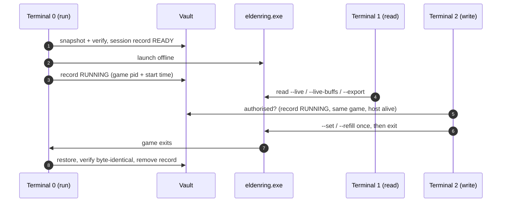

# Elden-Disk

> **Elden-Disk Memory I/O (Read / Write) Tools: offline save guard + live memory reader and writer for Elden Ring 1.17.1**  
> **Version:** `1.7.0` | **Spec Version:** `1.7.0` | **Platform:** Windows 10/11 (x64) | **Runtime:** Standalone Executable (`eldendisk.exe`) or Python 3.11+

Five parts with one job each:

- **Host (`run`):** takes a SHA-256 verified snapshot of your save, launches `eldenring.exe` **offline**, waits, and restores the save **byte for byte** when the game exits. It never opens the game's memory and writes no JSON.
- **Vault (`vault`):** snapshots, the session record, restore and recovery. It is the part that must not fail: a restore that could not finish leaves a record, and the next `run` refuses until `vault restore` has been run.
- **Reader (`read`):** prints every value once and exits; `--query NAME [NAME ...]` values or groups, shown as the same tree (`--flat`: one `full.path  value` row each); `--export` writes `disk-state.json` once; `--live` keeps going; `--live-buffs` / `--live-animations` are the monitors: one row per id, mapped or `Unknown`, `--mapped` / `--unmapped` to filter. `--param Magic.6230` shows any row of six of the game's tables (the params workbench), `--probe-params` finds where those tables are in memory, `--param-check [FILE]` compares a `regulation.bin` with the running game row by row. Values are addressed by **name** only. Read-only; works with or without `run`.
- **Writer (`write`):** `write --set NAME=VALUE ...` / `write --refill LIST` / `write --reset NAME ...`, applied once, by value name (`vigor`, `attrs.vigor`, `hp`, ...; and the game's own tables: `params.effects.1621000.effectEndurance`, or any numeric field of any row of Goods, Magic, SpEffect, Bullet, AtkParam_Pc and ShopLineup: `params.Magic.6230.mp`). `--reset` puts the game's own value back. It **refuses to write** unless `run`'s session record is valid for this very game process (exit code `5`), so every edit is covered by a snapshot.
- **Extension (`extension`):** builds things for the game outside the game. The first one, `innovate-items spells`, turns `extension.json` into a `regulation.bin` with your own incantation (design → built → secured, judged by a gate). With the vault ON, `run` swaps it in for one session and the vault puts the game's own file back with the save.
- **Zero configuration files:** `--save-dir` and `--vault` are remembered in the Windows Registry (`HKCU\Software\EldenDisk`). The vault lives in `%LOCALAPPDATA%\EldenDisk\vault` by default, never next to the exe, so a rebuild cannot delete it.

> [!IMPORTANT]
> **Parallel dimension:** edits made through `write`, and the `regulation.bin` an extension builds, exist only during the session. When the game closes, `run` restores the save taken before launch and the game's own `regulation.bin`, and verifies both byte for byte. The real playthrough is never changed by the sandbox.
>
> **Steam Cloud:** Elden Ring supports it, and it can sync the save when the game exits. Use Steam's offline mode or turn Steam Cloud off for Elden Ring during a session; `run` prints a reminder when Steam is running. Sync behaviour during a host session is **not verified** (spec test T10).
>
> **Real-game status (author, 1.17.1):** used on the real game: `run` restore (byte-identical), hard-kill recovery (`vault restore`), `write --set` by name, `read --live` and the two monitors, `write` of game params (`effectEndurance = -1` makes all four Black Flame rows burn without end), the params workbench (2026-10-09: `read --param`, `read --probe-params`, `read --param-check`, and `write --set params.<Table>.<id>.<field>` with `--reset` on six tables: a spell's FP cost and a bullet's life changed in the game and put back; a Black Flame that heals instead of burning; the slot-1 build equal to the game on every row of the six tables), and (2026-10-09) the **other world**: a `regulation.bin` built by the tool (`extension innovate-items spells`, gate passed, second decoder agreed on Python 3.14) swapped in by `run`, an own incantation sold, cast and healing, a boss beaten with infinite Black Flame, save and `regulation.bin` restored byte-identical; `extension innovate-items spells --secure` ran and wrote the secured copy. **Not tried in the game yet:** the poise part of the item (manual plan SW10), `run` using the secured copy (SC3-SC10), `motionInterval` on its own, and the Steam Cloud sync on exit (T10). Everything else is verified by unit tests with fake Windows and memory layers (about 1,000 tests; the 49 golden tests need the game's original `regulation.bin`). Keep a manual copy of your save folder **and** of the game's own `regulation.bin`.

---

## Three terminals



```commandline
eldendisk.exe run                                      (Terminal 0, leave open)
eldendisk.exe read --live                              (Terminal 1: every value, redrawn in place)
eldendisk.exe write --set vigor=99 level=150           (Terminal 2)
eldendisk.exe write --refill hp,fp,stamina             (Terminal 2)
eldendisk.exe write --set params.effects.1621000.effectEndurance=-1   (Terminal 2: Black Flame burns until the target dies)
eldendisk.exe write --reset all                        (Terminal 2: the game's own params back)
eldendisk.exe read --query attrs.*                     (any terminal: print once, exit)
```

To **keep** what `write` changed instead of rolling it back: let the game save (rest at a grace or quit to title), stop the host, close the game, then `eldendisk.exe vault keep --yes`.

If the session is cut short (power loss, host killed, console closed, second Ctrl+C), close the game and run `eldendisk.exe vault restore`.

---

## Safety architecture

1. **Host and vault never touch game memory.** `run` only queries a process start time; boundaries are enforced by `test_architecture.py` (module imports are checked by AST).
2. **Write capability lives in one file** (`writer/writer.py`) and is reached only from `write`, after `authorise()`.
3. **Invariant:** at every instant either the live save equals the snapshot and there is no record, or a record exists whose snapshot is verified.
4. **Restore never destroys unarchived data:** a modified save is copied into the vault before it is overwritten (`--no-archive-contaminated` to skip).
5. **Interrupts:** first Ctrl+C is absorbed (the game keeps running); second, console close, logoff or shutdown leave `RESTORE_PENDING`.
6. **No automatic recovery:** `run` with an owed restore exits `4` and prints the one command to run.
7. **No changes in the game folder,** with one exception: the `regulation.bin` that `extension innovate-items spells` built (or `--regulation FILE`) is swapped in for a `run --vault-on` session and the game's own file is put back, hash-checked, with the save (see below). `read --export` refuses to write there.
8. **EAC guard:** `read` and `write` stop when EasyAntiCheat is loaded; `run` refuses when anti-cheat processes are running.
9. **Few disk writes:** the export is written only when its content changed, at most every `--export-interval` (0.5 s); buff countdowns at most every `--timer-interval` (2 s).

---

## Quick start

Prerequisites: Windows 10/11 x64, Steam (offline mode is fine), Elden Ring 1.17.1 (included profile).

```commandline
# Terminal 0: back up, launch offline, restore afterwards
eldendisk.exe run
# several Steam accounts: pass the save folder once (remembered)
eldendisk.exe run --save-dir "C:\Users\<User>\AppData\Roaming\EldenRing\<SteamID64>"
```

```commandline
 Elden-Disk 1.7.0 · run
 ────────────────────────────────────────────────────────────────
   vault  %LOCALAPPDATA%\EldenDisk\vault
   save   C:\Users\<User>\AppData\Roaming\EldenRing\<SteamID64>
   game   C:\Program Files (x86)\Steam\steamapps\common\ELDEN RING\Game
 ────────────────────────────────────────────────────────────────
 12:00:00  ✓  vault  snapshot 20261006-120000, 2 files verified
 12:00:01  ·  game   launching eldenring.exe offline
 12:00:09  ✓  game   running, pid 8812; `read` allowed, `write` allowed
 ...                                      (game exits)
 12:31:40  ·  game   exited
 12:31:42  ✓  vault  ER0000.sl2 restored, byte-identical to the snapshot
```

Every command prints concise lines like these without any flag. Every event is also logged, logcat style, to `<vault>/eldendisk.log` (every terminal's command line and exit code included); add **`-v`** to a command to see that log live instead (`run -v`, `write --set level=150 -v`, `vault status -v` ...). `run -v` also shows the lines other terminals log.

**Farming (keep the progress):** `eldendisk.exe run --vault-off`, then `eldendisk.exe read --live --query runes` in another terminal. Nothing is backed up or restored, and `write` is refused.

---

## CLI overview

Run via `eldendisk.exe <command> [options]` or `python -m eldendisk <command> [options]`.

| Command | Role | Description |
|:---|:---|:---|
| `run [--vault-on \| --vault-off]` | **Host** | Snapshot, offline launch, wait, restore, verify. With the vault ON it swaps a `regulation.bin` in for the session: the secured copy when `extension.json` is unchanged, otherwise a new build that the gate must pass (or `--regulation FILE`). `--vault-off`: no backup, no restore, no swap (farming with `read`; `write` is refused) |
| `read [--query NAME [NAME ...]] [--export] [--live] [--live-buffs] [--live-animations] [--param TABLE.ID ...] [--probe-params] [--param-check [FILE]]` | **Reader** | No flag: every value once. `--query` one value or group; `--export` writes `disk-state.json` once; `--live` continuous (with `--export`: sample at `--hz`, write on change); `--live-buffs` / `--live-animations` monitors (`--mapped` / `--unmapped`); `--param` any row of Goods, Magic, SpEffect, Bullet, AtkParam_Pc, ShopLineup (a tree, `--flat` for one path per value); `--probe-params` where those tables are in memory; `--param-check [FILE]` a `regulation.bin` (default: the one in the game folder) against the game, row by row; `--json`, `--timeout`, `--export-interval`, `--timer-interval` |
| `write --set NAME=VALUE...` / `write --refill LIST` / `write --reset NAME...` | **Writer** | One-shot edits (values, and `params.…` fields of the game's tables, any numeric field of any row of six tables); `--reset` puts the game's own params back (it remembers the first value of a field in this game process); exit `5` without a valid session |
| `vault status \| list \| verify \| restore \| keep \| prune` | **Vault** | Session record, snapshots, recovery; `keep --yes` adopts the current save as the new baseline |
| `extension --list` \| `extension innovate-items spells --add all\|ID\|--secure` | **Extension** | Build things for the game outside the game. `innovate-items spells` turns `extension.json` into a `regulation.bin` with your own incantation (judged by a gate; `--secure` keeps the one you tried); `run` (vault ON) does the same build and swaps it in |
| `hash` | Tool | SHA-256 of `eldenring.exe` (profile key) |

**Exit codes:** `0` ok · `1` error / not applied · `2` unsupported exe, or a read-only `params` field named in `write` · `3` EAC · `4` restore pending · `5` no valid session · `130` interrupted.

Removed in 1.6.2: `sandbox` (now `write` and `vault`), top-level `effects` / `animations` (now `read --live-buffs` / `--live-animations`), JSON output of `run` (now `read --export`), the verbs `read effects|animations|export`, `write set|refill` (now flags) and `--once` (a read without `--live` is already one shot). Values are addressed by name only; there are no memory addresses or scans.

**Full references:** [docs/guilde/cli-commands-exe.md](docs/guilde/cli-commands-exe.md) (executable) · [docs/guilde/cli-commands.md](docs/guilde/cli-commands.md) (Python source) · [spec 1.7.0](docs/specs/elden-disk-spec-v1.7.0.md) · [changes 1.7.0](docs/wahy/changes-version-1.7.0.md) · [manual test plan 1.7.0](docs/experiments/extensional/innovate-items/spell/docs/manual-test-plan-1.7.0.md) · [spec 1.6.4](docs/specs/elden-disk-spec-v1.6.4.md) · [changes 1.6.4](docs/wahy/changes-version-1.6.4.md) · [manual test plan 1.6.4](docs/manual-tests/manual-test-plan-1.6.4.md) · [spec 1.6.3](docs/specs/elden-disk-spec-v1.6.3.md) · [changes 1.6.3](docs/wahy/changes-version-1.6.3.md) · [manual test plan 1.6.3](docs/manual-tests/manual-test-plan-1.6.3.md) · [params report](docs/experiments/params/sp-effect-params/sp-effect-params-hypothesis-report.md) · [params workbench (Phase 1)](docs/experiments/extensional/innovate-items/spell/docs/phase1-params-workbench.md) · [roadmap: innovate spells, all kinds](docs/experiments/extensional/innovate-items/spell/docs/roadmap-innovate-spells.md)

---

## 🌌 The other world (`regulation.bin`, 1.6.4) and extensions (1.7.0)

**Principle: the other world never touches the real one.** Everything done in a `run` session (the rules, the items, the values written, the changes to the save) exists for that session only. When the game exits, the vault puts back the save and the game's own `regulation.bin`, byte for byte, checked by hash. Nothing carries over: not the items, not the progress. The real playthrough stays exactly as it was, and it can be finished with no mod at all. The sandbox is for playing around on the days you want to; it is never required, and nothing in the real world can collapse because of it.

The vault keeps *the world as it was*. `extension innovate-items spells` builds *the world you want to play in*: a `regulation.bin` with your own incantation, made from a JSON file, offline, by the tool itself. With the vault ON, `run` builds it, swaps it in for one session and puts the game's own file back with the save.

```
extension.json (embedded in the exe)  --run (vault ON): build on the game's regulation.bin + gate-->  regulation.bin  --vault swaps-->  the game
                                        --extension innovate-items spells --secure (game closed)-->  regulation.secured.bin + spells.commit.json
next run, design unchanged: regulation.secured.bin is swapped, nothing is built
<vault>\extension\innovate-items\spells\
  regulation.bin            the latest build (gate passed, not yet confirmed)
  regulation.secured.bin    the copy you confirmed
  spells.commit.json        the design behind it + hashes
%LOCALAPPDATA%\EldenDisk\vault\
  20261008-0800\save\                 the save as it was
                bin\regulation.bin     the game's own file, kept to put it back
```

- **The design is `code/extension.json`** (section `innovate_items.spells`: the format allows up to 64 slots and the file in the repository has 20, **7 available in the game** (slots 1-7, the ones with a shop line; slots 8 and above are built but cannot be bought yet, deferred); the JSON schema is `spells.schema.json` in the `innovate_items.spells` package). You edit it; the dev pipeline's build embeds it in the exe (like `offsets.json`). An `extension.json` next to the exe, or `--spec FILE`, wins.
- **Design → built → secured.** `run` builds when there is no secured copy or the design changed (about 20 s) and prints why, with a field-by-field diff. When it worked in the game, close the game and run `extension innovate-items spells --secure`; after that `run` swaps the secured copy without building. Changing only `name` / `description` does not count as a change. Delete `spells.commit.json` to force a build.
- **Always on the game's own file.** The game's `regulation.bin` is checked against the known 1.17.1 original on every path; a modified file is refused with a `vault restore` hint.
- **Depends on the vault, like `write`.** No `--extension-on` flag: with `--vault-off` nothing is built or swapped. `extension --list` and `extension innovate-items spells --add all` build without starting the game.
- **The gate judges the finished file, read back from disk.** The frame must decode to the intended bytes, untouched blocks must be the game's own bytes, only the declared rows may change, the id chain, shop range, stock flag and heal sign must be right. Any problem or warning is a stop: nothing is swapped and the game is not started. Necessary, not sufficient: the game is the real test.
- **Spell kinds.** `buff` (default: a heal-over-time spell, up to 64 slots in the design, slot 1 tested in the game), `clone` (a copy of a game spell with its own cost, requirements, shop line and single values; passed in the game), and, passed in the game 2026-10-10 (E1), `enchant` and `buff` with `from` (a copy of a weapon/shield enchant or of a buff spell together with the template's own SpEffect rows, so its effect can be tuned: `"set": {"SpEffect.1626000.effectEndurance": 600}` makes a Black Flame Blade copy last ten minutes). `projectile` (P1 passed in the game 2026-10-10: a copy of a spell that throws Bullets, with its own Bullet and SpEffect rows, so range, life or the effect on hit can be tuned: `"set": {"SpEffect.1621000.effectEndurance": 30}` on a Black Flame copy burns for 30 s; since Phase 2.4 also with its own AtkParam_Pc rows, so `"AtkParam_Pc.62101.atkFire": ...` sets the damage) and `attack` (a copy of a spell that makes a direct attack, with its own AtkParam_Pc rows; passed in the game 2026-10-11: a copy of sorcery 4440 whose `"set": {"AtkParam_Pc.44400.atkMag": 1800}` hits about ten times as hard). AtkParam_Pc is the sixth table that grows; it grows at its end because a 6 MB table lies in front of it (T8 failed, T9 passed). Rows are appended to the tables, nothing existing changes (spec 1.7.0 sections 4b and 10b). Name and description are stored only; colour, icon and text (Level 3) need files inside the game's archives and are refused.
- `--regulation FILE` swaps another file instead of building. The 1.6.4 folder `<vault>\regulation\` is no longer read.
- The order is: build, back up the save and the game's file, write the session record, swap, launch. When the game closes, `run` restores the save **and** the game's file and checks both by hash. If either fails, the record stays and the next `run` is refused until `vault restore` finishes (exit `4`). `vault keep` keeps the current *save* only; the game's own file always comes back first.
- Offline only (as every param change). `write --set params.…` works inside a swapped session, so a new row can be tuned live.
- Details: [spec 1.7.0](docs/specs/elden-disk-spec-v1.7.0.md), [spec 1.6.4](docs/specs/elden-disk-spec-v1.6.4.md); the research is in the [item-customization handbook](docs/experiments/item-customization/item-customization-handbook.md).

---

## 🧪 Editable Attributes & Clamping Ranges

All edits supplied via `write --set` are clamped to valid game boundaries before writing:

| Attribute Name | Acceptable Range | Description |
|:---|:---:|:---|
| `level` | `1` – `713` | Character level number |
| `runes` | `0` – `999,999,999` | Current held Rune count |
| `vigor`, `mind`, `endurance`, `strength`, `dexterity`, `intelligence`, `faith`, `arcane` | `1` – `99` | Character stats |
| `hp` | `1` – `Max HP` | Current HP (cannot drop below 1) |
| `fp`, `stamina` | `0` – `Max` | Current FP / Stamina |
| `write --refill hp,fp,stamina` | — | Refills vitals to maximum |

Names: full path (`character.attributes.vigor`), short (`attrs.vigor`, `vigor`) or alias (`rune`, `hp`, `fp`). Groups with a wildcard (`attrs.*`, `vitals.*.current`) set several at once. Bare `*`, `character.*` and `ALL` are refused. Values the game or the tool computes (`hp.maximum`, `hp.base`, ...) are read-only, and the refusal says why. `read --query NAME` uses the same names.

---

## 🔥 Game params (`params.…`, new in 1.6.3)

The game keeps its own data tables in memory. `write` can change a field of one row of the `SpEffectParam` table (the game's table of effects: buffs, burns, ...) while the game runs; `read` shows them as the third block of `disk-state.json`, after `systems` and `character`:

```json
"params": {
  "effects": {
    "1621000": { "name": "Black Flame", "effectEndurance": 2.0, "motionInterval": 0.1, "changeHpRate": 0.1,
                 "changeHpPoint": 1, "atkOccurrenceSpEffectId": -1, "vfxId": 9010 },
    "1623000": { "name": "Scouring Black Flame", "...": "same fields" },
    "1625000": { "name": "Black Flame Ritual",    "...": "same fields" },
    "1626001": { "name": "Black Flame Blade",     "...": "same fields" }
  }
}
```

```commandline
eldendisk.exe read --query params.effects.1621000
eldendisk.exe write --set params.effects.1621000.effectEndurance=-1                 # one field
eldendisk.exe write --set "params.effects.*.effectEndurance=-1"                                  # all four rows
eldendisk.exe write --reset params.effects.1621000.effectEndurance                  # one field back
eldendisk.exe write --reset params.effects.1621000                                  # one row back
eldendisk.exe write --reset all                                                         # every param back
```

- **`effectEndurance`** is how long the effect lasts, in seconds: `-1` = until it is removed (Black Flame burns until the target dies), `0` = a single instant tick. The game's own value is `2`. `motionInterval` (seconds between ticks), `changeHpRate` and `changeHpPoint` (the size of each tick; see the field reference in the params report folder) can be set too. Values outside the allowed range are clamped and the output says so.
- **`atkOccurrenceSpEffectId` and `vfxId` are read-only** (`exit 2`): a wrong id can crash the game. A pattern skips them and says so.
- Names are typed in full, `params.effects.<id>.<field>` (a row is its game id), in any letter case; a `*` pattern sets several values. `name` is the row's text from `offsets.json`: shown, never written. `--reset` takes a field, a row, or `all`, and puts the **game's own values** (from `offsets.json`) back.
- The rows are listed in `offsets.json`: 1621000 Black Flame, 1623000 Scouring Black Flame, 1625000 Black Flame Ritual, 1626001 Black Flame Blade; another row is one line in the profile.
- Same safety gate as every `write`: only inside a valid `run --vault-on` session. The edit lives in the game's memory, **not in the save**, and is gone when the game closes.
- Every call finds the table again through pointer chains and checks it (the header must add up, the row id must be there) before it reads or writes; a check that fails stops the call.

> [!WARNING]
> **Offline only.** Params are what the game trusts: with anti-cheat active, or online, changing them can get an account banned. `run` starts the game offline for this reason. A burn already on an enemy keeps the duration it had; a new cast uses the new value.

How the table was found and what was and was not tested: [docs/experiments/params/sp-effect-params](docs/experiments/params/sp-effect-params/sp-effect-params-hypothesis-report.md).

### Any row of six tables (the params workbench, 2026-10-09)

Besides the four Black Flame rows above, `read` and `write` reach any row of **Goods** (`EquipParamGoods`), **Magic**, **SpEffect**, **Bullet**, **AtkParam_Pc** and **ShopLineup**, with the field names of Paramdex. Offline, inside a `run` session, like every `write`.

```commandline
eldendisk.exe read --param Magic.6230                       # the whole row as a tree
eldendisk.exe read --param Magic.6230.mp* Bullet.10621001 --flat      # fields by pattern, one params.<Table>.<id>.<field> path per value
eldendisk.exe write --set params.Magic.6230.mp=0            # Scouring Black Flame costs 0 FP
eldendisk.exe write --set params.Bullet.10625002.life=12    # Black Flame Ritual's flame lasts 12 s (-1: never ends)
eldendisk.exe write --reset params.Magic.6230.mp            # the game's own value back (also: a row, a pattern, all)
eldendisk.exe read --param-check                            # the regulation.bin in the game folder against the game, row by row
```

- A value is checked against the field's type and bit width (an error, not a clamp). A field that holds the id of another row gets a note: an id that matches nothing can crash the game.
- `--reset` puts back the value the game had **before the first change in this game process** (kept in `params-snapshot.json` in the vault folder, tied to the game's pid and start time; a new game process starts with nothing to put back).
- **What the game reads when** (measured): a **Magic** row at the cast (cost, flags), a **Bullet** row when the bullet is created (`life` is its lifetime in seconds). A value written stays through Quit to Title and Continue and is gone when the game process ends. A change acts on what is created afterwards: a flame already in the world keeps the values it was born with, so `--reset` changes the next cast, not the one burning.
- `read --param-check` found the slot-1 build equal to the game on every row of all six tables (Goods 2,330, Magic 318, SpEffect 11,356, Bullet 15,475, AtkParam_Pc 11,017, ShopLineup 1,297 rows): the game does not change the param data when it loads the file, and the rows an extension added are in the game exactly as built. A value changed with `write` shows as a difference too.
- Plan and results: [docs/…/spell/docs/phase1-params-workbench.md](docs/experiments/extensional/innovate-items/spell/docs/phase1-params-workbench.md); where it leads (spells of every kind): [docs/…/spell/docs/roadmap-innovate-spells.md](docs/experiments/extensional/innovate-items/spell/docs/roadmap-innovate-spells.md).
---

## 📦 Building Standalone Executable & E2E Dev Pipeline

```commandline
# The E2E pipeline: all tests -> clean build of ./build/dist/eldendisk.exe (the .json configs embedded) -> a status report
# (where the exe is, size, SHA-256, version, embedded files, time of each step). It ends there; it does not start the game.
python code/tools/dev_pipeline.py

# Options: --skip-tests, --no-embed (copy the .json files next to the exe), --engine nuitka, --icon ICO
python code/tools/dev_pipeline.py --skip-tests

# Then start it yourself (it can sit anywhere; everything it produces goes to %LOCALAPPDATA%\EldenDisk)
.\build\dist\eldendisk.exe run -v
```

---

## 📊 Export document (`read --export` → `disk-state.json`)

```json
{
  "systems": {
    "profile": { "sha256": "...", "game": "eldenring.exe", "version": "1.17.1" },
    "features": { "buffs_supported": true, "animations_supported": true, "sandbox_supported": true },
    "status": { "pid": 1234, "tool_state": "CONNECTED", "anti_cheat_state": "DISABLED_OFFLINE", "game_connected": true, "ignored": { "buffs": 0, "animations": 0 } },
    "session": { "mode": "telemetry", "read_only": true, "sandbox": false }
  },
  "character": { "level": 386, "vitals": { ... }, "runes": { ... }, "attributes": { ... },
                 "buffs": { "3971": { "name": "Gold-Pickled Fowl Foot", "categories": "CONSUMABLES", "times": { ... } } },
                 "animations": { ... } },
  "params": { "effects": { "1621000": { "name": "Black Flame", ... } } }
}
```

`character.buffs` and `character.animations` are named from `chr_state_ids.json` (`buffs` and `animations` objects keyed by id; an entry is `name`, optional `categories` and `abilities`):

```json
{ "buffs":      { "3971":    { "name": "Gold-Pickled Fowl Foot", "categories": "CONSUMABLES", "abilities": "..." } },
  "animations": { "2020110": { "name": "Running", "categories": "MANNER" } } }
```

The 1.6.2 file was one flat list with a `sources` field; `python code/tools/convert_state_ids.py chr_state_ids.json` converts it (a backup is kept as `.bak`). `character.effects` is now `character.buffs`, `features.effects_supported` is `buffs_supported`, and `systems.status.ignored.effects` is `.buffs`.

---

## 🧪 Testing & Quality Assurance

```commandline
# Run unit test suite (about 1,000 tests; the 49 golden ones need ELDENDISK_REGULATION_ORIG=<the game's original regulation.bin> and take a few minutes)
python -m pytest

# Run soak stability check (V-06)
python code/tools/soak_check.py
```
