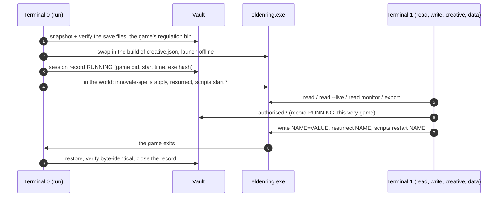

# Elden-Disk

> **Elden-Disk is the Elden Ring Memory Disk I/O Tools: a portal into a parallel world of Elden Ring 1.17.1**  
> **Version:** `1.8.0` | **Spec Version:** `1.8.0` | **Platform:** Windows 10/11 (x64) | **Runtime:** Standalone Executable (`eldendisk.exe`) or Python 3.11+

Elden-Disk works as **CLI commands in a console** and has no user interface it does not need: you open a terminal, run a command, it does its
work and ends. Everything the tool can do is a command, and every command reads the same way.

**Philosophy: the portal.** Elden-Disk is a portal into a parallel world of the real game world (Elden Ring, the Lands Between). Through the
portal the world mirrors everything of the game, and you can play with it in **creative ways**: new spells you design, great enemies
brought back, scripts that change the game while it runs. When you leave through the portal, the real world is back exactly as it was:
**nothing you did inside comes back with you.** The vault is the portal: it keeps the real world (the save files `ER0000.sl2`,
`ER0000.sl2.bak`, `ER0000.err`, `ER0000.err.bak`, `steam_autocloud.vdf`, and the game's own files) before you go in, and puts it back,
byte for byte, when you come out.

> [!IMPORTANT]
> **Offline only.** `run` starts the game offline; with the anti-cheat running the tool refuses (exit `3`). Changing the game's own data
> online can get an account banned.
>
> **Steam Cloud** may sync the save when the game exits; this is not verified. Use Steam's offline mode or turn Steam Cloud off for Elden
> Ring during a session; `run` says so when Steam is running.
>
> Keep a manual copy of your save folder **and** of the game's own `regulation.bin`.

---

## The backbone: running the game ⟶ loading the world ⟶ playing ⟶ quitting the game

```text
vault: back up the save files (and swap in the regulation.bin built from creative.json)      `run`, the portal opens
 │
 ├─ read      the game's memory through the pointer chains of the profile (offsets.json); every value is a name in ONE document
 ├─ write     the game's memory through the same chains, only inside the session `run` started (vault ON)
 ├─ creative  what is built and run next to the game: scripts, innovate-spells, resurrect
 ├─ data      export, reset, check, probe
 │
vault: restore the save files and the game's own files (byte for byte)                      the game closes, the portal closes
```



Rules every command follows:

1. **One document.** Whatever the tool knows of the running game is a path in one document (`systems`, `character`, `params`,
   `creative`). `read` shows it, `write` and the scripts' `tools.write` change it, `export` writes it as `output\disk.json`.
2. **Read anywhere, write only through the portal.** Reading needs no session. Every write (a value, a param, a text, a colour, a flag)
   needs the session `run` started with the vault ON, for this very game process, and goes through the same gate (exit `5` otherwise).
3. **Memory only.** Nothing is written to the game folder or to the save files; what is built from `creative.json` (`regulation.bin`) is
   swapped in and put back by the vault.
4. **One command, one job, then it ends.** What stays open is what must: `run`, `read --live`, the monitors, `export --live`, the scripts'
   host.
5. **The game's own data first.** Ids, names, flags and places come from the game's files (its params, event scripts and text); a list
   made by hand is the exception, and a test checks it against the game.

---

## Commands

Run via `eldendisk.exe <command> [options]` or `python -m eldendisk <command> [options]`.

| **Level** | **Command** | **What it does** |
|:---|:---|:---|
| the portal | `run [--vault-on \| --vault-off]` | back up the save files, swap in the build of `creative.json`, launch offline; once a character is in the world `innovate-spells apply`, `resurrect` (the list of `creative.json`) and `scripts start *`; restore everything when the game closes |
| 1st: vault | `vault status \| list \| verify \| restore \| keep \| prune` | the snapshots and the session record; `restore` after a session cut short, `keep --yes` to keep the current save |
| 2nd: core | `read [* \| all \| NAME \| ID \| PATH ...] [--live] [--tree \| --flat \| --json]` | the document, or a part of it: `hp`, `attrs.*`, `params.Magic.6230.mp`, `creative.resurrect.great_enemies.margit` |
| 2nd: core | `read monitor \| monitor-buffs \| monitor-animations [--mapped \| --unmapped]` | one row per buff / animation id that appears (`--unmapped`, the default: the ids `names.json` does not name yet) |
| 2nd: core | `write NAME=VALUE ...`, `write NAME=default`, `write` | change a value the document shows; `default` = the game's own value; `write` alone lists the names and their ranges |
| 3rd: creative | `scripts [* \| all]`, `scripts start \| restart \| stop \| status [NAME[:ID[:PROCESS_ID]]]`, `scripts add \| remove \| change PATH` | your Python scripts next to the game, controlled from another terminal |
| 3rd: creative | `innovate-spells`, `innovate-spells build [all \| NAME \| ID ...] \| secure \| apply` | new spells: `creative.json` ⟶ a `regulation.bin` judged by a gate ⟶ secured; their texts and colours into the game |
| 3rd: creative | `resurrect NAME \| ID \| PATH ... \| all [--dry-run]` | a boss you have beaten, alive again for the session |
| data | `export [--live]` | the document to `%LOCALAPPDATA%\EldenDisk\output\disk.json` |
| data | `reset [all \| runes \| buffs \| animations \| monitor]` | the read baselines start again from now (`runes.delta` = 0, the monitors' history); nothing is written to the game |
| data | `check [FILE]` | a `regulation.bin` against the game, row by row |
| data | `probe` | where the game's param tables lie in memory (for a new game version) |
| tooling | `hash`, `--version` | SHA-256 of `eldenring.exe` (the key of its profile), the tool's version |

**Naming.** Everywhere a thing is named, three forms work: the **path** in the document (`creative.resurrect.great_enemies.12050800`),
the **id** (`12050800`) and the **name** in any letter case or a part of it (`mohg lord`). `*` and `all` mean every one.

**Exit codes:** `0` done · `1` error / not applied · `2` not supported · `3` anti-cheat running · `4` restore pending · `5` no portal ·
`130` interrupted.

**Full references:** [docs/guilde/cli-commands.md](docs/guilde/cli-commands.md) (Python source) ·
[docs/guilde/cli-commands-exe.md](docs/guilde/cli-commands-exe.md) (executable) · [spec 1.8.0](docs/specs/elden-disk-spec-v1.8.0.md) ·
[changes 1.8.0](docs/wahy/changes-version-1.8.0.md).

---

## Quick start

Prerequisites: Windows 10/11 x64, Steam (offline mode is fine), Elden Ring 1.17.1 (included profile).

```commandline
# Terminal 0: the portal (leave it open)
eldendisk.exe run
# several Steam accounts: pass the save folder once (remembered)
eldendisk.exe run --save-dir "C:\Users\<User>\AppData\Roaming\EldenRing\<SteamID64>"
```

```commandline
# Terminal 1, once a character is loaded
eldendisk.exe read runes hp attrs.*                              # once
eldendisk.exe read character.runes --live                        # kept current
eldendisk.exe write vigor=99 level=150                           # inside the portal
eldendisk.exe write params.effects.1621000.effectEndurance=-1    # Black Flame burns until the target dies
eldendisk.exe write params=default                               # the game's own values back
eldendisk.exe resurrect "mohg lord"                              # rest at a Site of Grace: he is there
eldendisk.exe scripts                                            # your scripts and their state
```

To **keep** what you changed instead of rolling it back: let the game save (rest at a grace or quit to title), close the game, end `run`,
then `eldendisk.exe vault keep --yes`. If the session is cut short (power loss, `run` killed, console closed): close the game and run
`eldendisk.exe vault restore`. For reading while you farm and keep what you earn: `run --vault-off` (no backup, no restore, nothing
written).

Every command prints concise lines. Every event is also logged, logcat style, to `<vault>\eldendisk.log` (every terminal's command line
and exit code included); add **`-v`** to any command to see that log live instead.

---

## Creative

What exists only in the parallel world. Each part depends on the vault, like `write`; `run` starts what `creative.json` names.

```json
{
  "innovate_spells": { "maximum": 20, "slots": { "reverse_cursed_technique": { "kind": "projectile", "from": 6421, "...": "..." } } },
  "scripts": { "added": ["D:\\my-scripts\\boss_rush.py"] },
  "resurrect": { "great_enemies": { "activate": ["margit", "12050800"] } }
}
```

### `innovate-spells`: new spells

`creative.json` (embedded in the exe; one next to it, or `--spec FILE`, wins) describes your spells: the kind (`buff`, `clone`, `enchant`,
`projectile`, `attack`), the game's spell it is made `from`, what it `requires`, where it is sold, and `customs` (the numbers of the game's
rows it changes, its texts and colours). `run` builds a `regulation.bin` with them on the game's own file, the **gate** judges the file read
back from disk (the frame decodes to the intended bytes, untouched blocks are the game's own, only the declared rows change, ...), and the
vault swaps it in for the session. When it worked in the game, close the game and run `innovate-spells secure`: `run` then swaps the
secured copy without building while the spells do not change. `innovate-spells apply` (started by `run`) puts the texts and the colours
(the fire of Flame, Grant Me Strength, the ring of runes, the eyes) into the running game. The files live in `<vault>\creative\innovate-spells\`.

### `resurrect`: great enemies again

Any of the 212 great enemies (every enemy fought under the big health bar, the DLC included) that you have beaten can come back for the
session, with its intro, its runes and its drop: its event flags are turned off in the game's memory only. `read
creative.resurrect.great_enemies` shows the ones that are defeated now; `resurrect margit` brings one back. When the game closes the vault
puts the save back and the boss is dead again.

### `scripts`: your Python next to the game

```python
from edstdlib import *

class RctColoursFollowTheSpell(Interface):
    every = 0.2                                               # seconds between two calls of loop()

    def loop(self):
        x = tools.read()                                      # the document, as one object
        chosen = x.character.equipment.magic.selected.id == 2230000
        fire = x.creative.innovate_spells.reverse_cursed_technique.design.customs.advanced.colors["Magic.6421.castSfxId"]
        fire.main = "#90D5FF" if chosen else None             # None: the game's own colour
        tools.write(x)                                        # writes only what changed
```

All the scripts of a session run in **one host process**, each in a thread of its own: the defaults the exe carries
(`code/eldendisk/creative/scripts/defaults/`) and the ones of `scripts.added` (`scripts add PATH`). From another terminal,
`scripts start | restart | stop NAME` reaches the host through a small request file in `<vault>\creative\` (no port is opened), and
`scripts status` (or `read creative.scripts`) shows how each is doing. Examples to copy: `code/tests/external_scripts/`.

---

## The document (the single source of truth)

`read` shows it, `export` writes it, `tools.read()` gives it to a script; every name above is a path in it.

```json
{
  "systems": {
    "profile": { "sha256": "...", "game": "eldenring.exe", "version": "1.17.1" },
    "features": { "buffs_supported": true, "animations_supported": true, "creative_supported": true },
    "status": { "pid": 46224, "tool_state": "IDLE", "anti_cheat_state": "DISABLED_OFFLINE", "game_connected": true },
    "session": { "mode": "creative", "read_only": false, "creative": true }
  },
  "character": { "level": 386, "vitals": { "...": "..." }, "runes": { "total": 55214603, "baseline": 55214603, "delta": 0 },
                 "attributes": { "...": "..." }, "buffs": { "...": "..." }, "animations": { "...": "..." }, "equipment": { "...": "..." } },
  "params": { "effects": { "1621000": { "name": "Black Flame", "effectEndurance": 2.0, "...": "..." } } },
  "creative": {
    "scripts": { "host": { "process_id": 26528, "state": "running", "started": "...", "scripts": 1 }, "defaults": { "...": "..." }, "added": {} },
    "innovate_spells": { "2230000": { "id": "reverse_cursed_technique", "slot": 1, "rows": { "...": "..." }, "design": { "...": "..." } } },
    "resurrect": { "great_enemies": { "12050800": { "name": "Mohg, Lord of Blood", "place": "Mohgwyn Palace", "defeated": true } } }
  }
}
```

`character.buffs` and `character.animations` are named from `names.json` (the reader's: `code/eldendisk/reader/names.json`, always in
the exe; one next to the exe wins). The full document is in [spec 1.8.0 part 2](docs/specs/elden-disk-spec-v1.8.0.md).

---

## Safety architecture

1. **The host and the vault never touch the game's memory.** `run` only queries a process start time; the boundaries of the packages are
   enforced by `tests/test_architecture.py` (imports checked by AST).
2. **Write capability lives in few places** (the writer, `write`, `resurrect`, the scripts' backend) and is reached only after
   `authorise()`: the session record must name this very game process (pid, start time, exe hash).
3. **Invariant:** at every instant either the live save equals the snapshot and there is no record, or a record exists whose snapshot is
   verified.
4. **Restore never destroys unarchived data:** a changed save is copied into the vault before it is overwritten.
5. **Interrupts:** the first Ctrl+C is absorbed (the game keeps running); a second one, a closed console, a logoff or a shutdown leave
   `RESTORE_PENDING`, and the next `run` exits `4` with the one command to run.
6. **The game folder is left as it was,** but for the `regulation.bin` the session swaps in and puts back, hash-checked; the game's own
   file is checked against the known original on every path.

---

## Where things live

```text
%LOCALAPPDATA%\EldenDisk\                        everything the tool keeps (never next to the exe: a new build cannot delete it)
 ├─ vault\                                       snapshots, session.json, creative\ (builds, the scripts' status), memory-cache.json,
 │                                               params-snapshot.json, eldendisk.log
 ├─ baselines.json                               what `reset` set
 ├─ exe-sha256.json                              the hash of eldenring.exe, kept while the file stays the same
 └─ output\disk.json                             what `export` writes
<exe folder>\                                    eldendisk.exe; offsets.json, names.json, creative.json when you put them next to it
```

`offsets.json` holds one **profile** per `eldenring.exe` (by its SHA-256, see `hash`): the pointer chains and the blocks each feature
needs (`text`, `equipment`, `event_flags`, ...). A new game version: [docs/handbook/adding-a-profile.md](docs/handbook/adding-a-profile.md).

---

## Building the executable

```commandline
# all tests -> a clean build of ./build/dist/eldendisk.exe (offsets.json and creative.json embedded; names.json, the great-enemies table
# and the default scripts always) -> a status report (where the exe is, size, SHA-256, version, embedded files, the time of each step)
python code/tools/dev_pipeline.py

# --skip-tests, --no-embed (offsets.json and creative.json next to the exe), --engine nuitka, --icon ICO,
# --keep-app-data (by default %LOCALAPPDATA%\EldenDisk, with the vault and its save snapshots, is removed before the build)
python code/tools/dev_pipeline.py --skip-tests

# then start it yourself (it can sit anywhere)
.\build\dist\eldendisk.exe run -v
```

The build writes a `README.md` next to the exe from [docs/guilde/README-exe.md](docs/guilde/README-exe.md) and
[docs/guilde/cli-commands-exe.md](docs/guilde/cli-commands-exe.md).

---

## Testing

```commandline
# the unit tests (about 1,700; the golden ones need ELDENDISK_REGULATION_ORIG=<the game's original regulation.bin>)
python -m pytest

# the soak check of an export kept live (V-06)
python code/tools/soak_check.py
```

Everything is verified by unit tests with fake Windows and memory layers; what was tried in the real game is written in each spec
(section "Measured") and in the changes of each version ([docs/wahy](docs/wahy)).
