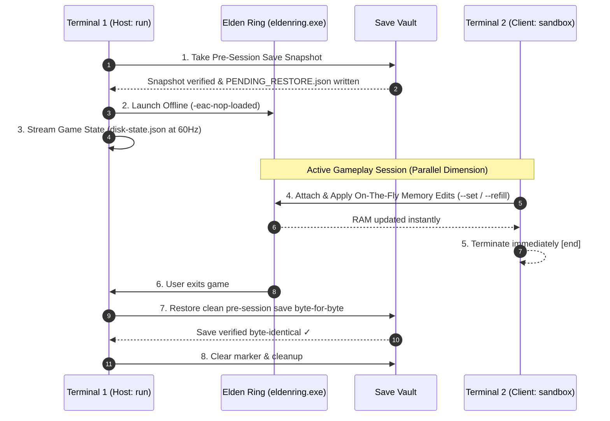

# EldenDisk

> **Offline Save Sandbox & Memory Tool for Elden Ring: Host/Client Architecture**  
> **Version:** `1.6.0` | **Spec Version:** `1.6.0` | **Platform:** Windows 10/11 (x64) | **Runtime:** Standalone Executable or Python 3.11+

EldenDisk is a specialized **Save Sandbox & Memory Tool** designed for Elden Ring (v1.17.1). It streams 60Hz real-time character state to `output/disk-state.json` and enables on-the-fly memory editing under a strict **Parallel Dimension Philosophy**:

- **Host Session & Save Guard (`run`):** Takes an automatic SHA-256 verified save snapshot into `backup/vault`, launches `eldenring.exe` **offline**, streams live game state to JSON, and **restores the clean save byte-for-byte when the game closes**.
- **On-The-Fly Memory Writer Client (`sandbox`):** Attaches dynamically to the active offline session, applies attribute edits (`--set`, `--refill`) instantly on-the-fly, and exits immediately (`[end]`).
- **Zero Configuration Files:** Remembers `--save-dir` in Windows Registry (`HKCU\Software\EldenDisk`) leaving zero config files in tool or build directories.

---

> [!IMPORTANT]
> **🌌 Parallel Dimension Guarantee (100% Clean Account Safety):**  
> All memory edits made via `sandbox` exist **only during the active offline session (a temporary parallel dimension)**. When the game closes, `run` restores your live save folder byte-for-byte back to the exact pre-session snapshot taken before the game opened. Nothing from your sandbox modifications ever pollutes your real character save or account.

---

## 🏗️ Host / Client Architecture & Lifecycle



---

## 🔑 Core Principles & Safety Architecture

1. **Host/Client Separation:** `run` acts as the Session Host & Save Guard. `sandbox` acts as a fast, non-blocking client that sends attribute edits to the running game without needing to close or restart the game.
2. **Byte-Identical Save Restoration:** `run` takes a full SHA-256 verified save snapshot before the game starts. When the game closes, `run` restores the clean pre-session save byte-for-byte.
3. **Zero Configuration Files:** Remembers `--save-dir` in Windows Registry (`HKCU\Software\EldenDisk`), leaving zero loose config files in tool or build directories.
4. **Zero Disk Changes in Game Folder:** Never modifies, renames, or creates files inside the Elden Ring installation directory.
5. **Anti-Cheat Guard (EAC Safe):** Refuses to attach or edit if EasyAntiCheat (`easyanticheat.dll`, etc.) is active.
6. **Event-Driven Persistence:** Polling runs at locked 60FPS. Disk updates (`disk-state.json`) occur only when state data changes, preserving SSD health.
7. **Window Focus Detection (`IDLE` State):** Pauses polling when the game is unfocused, saving CPU resources.
8. **Crash Recovery Guarantee (`sandbox restore`):** If a system crash or power outage occurs during play, running `eldendisk.exe sandbox restore` immediately restores your clean pre-session save snapshot.

---

## ⚡ Quick Start (2-Terminal Workflow)

### Prerequisites
1. Windows 10 or 11 (64-bit).
2. Steam Client running (Offline mode supported).
3. Supported Elden Ring executable (Version 1.17.1 included out-of-the-box).

---

### Terminal 1: Launch Host Session (`run`)

```commandline
# Launch game offline with save protection + state logger
eldendisk.exe run -v

# (Optional - If multiple Steam accounts exist, specify --save-dir once; remembered in Windows Registry)
eldendisk.exe run --save-dir "C:\Users\<User>\AppData\Roaming\EldenRing\<SteamID64>" -v
```

#### Terminal 1 Verbose Output Example:

```commandline
[config] offsets=offsets.json (embedded)
[config] effects=chr_state_ids.json (embedded)
state -> PREFLIGHT
state -> SNAPSHOTTING
[vault] backup save C:\Users\<User>\AppData\Roaming\EldenRing\76561198296924569 (steamID: 76561198296924569) to D:\...\backup\vault\20261006-120000 ✓
snapshot 20261006-120000: 2 file(s) verified ✓
state -> RUNNING
[CONNECTED]
...
(when game exits)
state -> RESTORING
[vault] restored save from D:\...\backup\vault\20261006-120000 to C:\Users\<User>\AppData\Roaming\EldenRing\76561198296924569 ✓
[vault] verification passed: restore verified; save folder is byte-identical to snapshot ✓
state -> CLEANUP
state -> IDLE
```

---

### Terminal 2: Apply On-The-Fly Edits While Playing (`sandbox`)

While the game is open, open Terminal 2 and apply edits dynamically:

```commandline
# Set Vigor to 90 instantly on-the-fly (Silent by default; use -v for confirmation)
eldendisk.exe sandbox --set vigor=90 -v

# Set Level to 150 and max Runes
eldendisk.exe sandbox --set level=150 --set runes=999999999 -v

# Refill HP, FP, Stamina to maximum
eldendisk.exe sandbox --refill hp,fp,stamina -v
```

#### Terminal 2 Output Example (with `-v`):

```commandline
[sandbox] vigor: set to 90
[sandbox] Applied 1 edit(s) on-the-fly successfully. ✓
```

*(Without `-v`: silent execution with zero console output)*

---

## 🛠️ CLI Commands Overview

Run via `eldendisk.exe <command> [options]` or `python -m eldendisk <command> [options]`.

| Command | Role | Description |
|:---|:---|:---|
| [`run`](#terminal-1-launch-host-session-run) | **Host & Save Guard** | Takes save snapshot, launches game offline, streams `disk-state.json`, restores save on exit |
| [`sandbox`](#terminal-2-apply-on-the-fly-edits-while-playing-sandbox) | **Memory Writer Client** | Attaches on-the-fly to active game, applies `--set` / `--refill` edits, exits immediately |
| `sandbox restore` | **Recovery** | Restores clean save after a crashed or interrupted session |
| `sandbox status` | **Status** | Checks vault marker status and snapshot count |
| `sandbox list` / `verify` / `prune` | **Vault Tools** | Lists, verifies, or cleans up older save snapshots |
| `build` | **Compiler** | Compiles project into standalone `./build/dist/1.6.0/.../eldendisk.exe` |

---

## 🧪 Editable Attributes & Clamping Ranges

All edits supplied via `--set` are clamped to valid game boundaries before writing:

| Attribute Name | Acceptable Range | Description |
|:---|:---:|:---|
| `level` | `1` – `713` | Character level number |
| `runes` | `0` – `999,999,999` | Current held Rune count |
| `vigor`, `mind`, `endurance`, `strength`, `dexterity`, `intelligence`, `faith`, `arcane` | `1` – `99` | Character stats |
| `hp` | `1` – `Max HP` | Current HP (cannot drop below 1) |
| `fp`, `stamina` | `0` – `Max` | Current FP / Stamina |
| `--refill hp,fp,stamina` | — | Refills vitals to maximum |

---

## 📦 Building Standalone Executable & E2E Dev Pipeline

```commandline
# Build standalone executable with embedded configs
python -m eldendisk build -c -em

# Run E2E pipeline (pre-check tests + build + dry run)
python code/tools/dev_pipeline.py --dry-run
```

**Full Command References:**
- **[docs/cli-commands-exe.md](docs/cli-commands-exe.md)** (Executable CLI Reference)
- **[docs/cli-commands.md](docs/cli-commands.md)** (Python Source CLI Reference)

---

## 📊 Connection State Machine (`disk-state.json`)

```json
{
  "systems": {
    "profile": { "sha256": "...", "game": "eldenring.exe", "version": "1.17.1" },
    "features": { "effects_supported": true, "animations_supported": true, "sandbox_supported": true },
    "status": { "pid": 1234, "tool_state": "CONNECTED", "anti_cheat_state": "DISABLED_OFFLINE", "game_connected": true, "ignored": { "effects": 0, "animations": 0 } },
    "session": { "mode": "telemetry", "read_only": true, "sandbox": false }
  },
  "character": { ... }
}
```

---

## 🧪 Testing & Quality Assurance

```commandline
# Run unit test suite (145+ tests)
python -m pytest

# Run soak stability check (V-06)
python code/tools/soak_check.py
```
