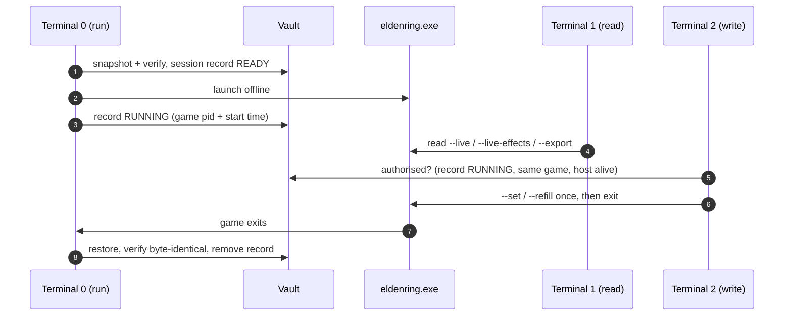

# Elden-Disk

> **Elden-Disk Memory I/O (Read / Write) Tools: offline save guard + live memory reader and writer for Elden Ring 1.17.1**  
> **Version:** `1.6.2` | **Spec Version:** `1.6.2` | **Platform:** Windows 10/11 (x64) | **Runtime:** Standalone Executable (`eldendisk.exe`) or Python 3.11+

Four parts with one job each:

- **Host (`run`):** takes a SHA-256 verified snapshot of your save, launches `eldenring.exe` **offline**, waits, and restores the save **byte for byte** when the game exits. It never opens the game's memory and writes no JSON.
- **Vault (`vault`):** snapshots, the session record, restore and recovery. It is the part that must not fail: a restore that could not finish leaves a record, and the next `run` refuses until `vault restore` has been run.
- **Reader (`read`):** prints every value once and exits; `--query NAME` one value or group; `--export` writes `disk-state.json` once; `--live` keeps going; `--live-effects` / `--live-animations` are the monitors: one row per id, mapped or `Unknown`, `--mapped` / `--unmapped` to filter. Values are addressed by **name** only. Read-only; works with or without `run`.
- **Writer (`write`):** `write --set NAME=VALUE ...` / `write --refill LIST`, applied once, by value name (`vigor`, `attrs.vigor`, `hp`, ...). It **refuses to write** unless `run`'s session record is valid for this very game process (exit code `5`), so every edit is covered by a snapshot.
- **Zero configuration files:** `--save-dir` and `--vault` are remembered in the Windows Registry (`HKCU\Software\EldenDisk`). The vault lives in `%LOCALAPPDATA%\EldenDisk\vault` by default, never next to the exe, so a rebuild cannot delete it.

> [!IMPORTANT]
> **Parallel dimension:** edits made through `write` exist only during the session. When the game closes, `run` restores the save taken before launch and verifies it.
>
> **Steam Cloud:** Elden Ring supports it, and it can sync the save when the game exits. Use Steam's offline mode or turn Steam Cloud off for Elden Ring during a session; `run` prints a reminder when Steam is running. Sync behaviour during a host session is **not verified** (spec test T10).
>
> **Real-game status (author, 1.17.1):** `run` restore (byte-identical), hard-kill recovery (`vault restore`), `write --set` by name, `read --live` and the two monitors have been used on the real game. Everything else is verified by unit tests with fake Windows and memory layers (456 tests); the Steam Cloud sync on exit (T10) is still untested. Keep a manual copy of your save folder.

---

## Three terminals



```commandline
eldendisk.exe run                                      (Terminal 0, leave open)
eldendisk.exe read --live                              (Terminal 1: every value, redrawn in place)
eldendisk.exe write --set vigor=99 level=150           (Terminal 2)
eldendisk.exe write --refill hp,fp,stamina             (Terminal 2)
eldendisk.exe read --query attrs.*                     (any terminal: print once, exit)
```

To **keep** what `write` changed instead of rolling it back: let the game save (rest at a grace or quit to title), stop the host, close the game, then `eldendisk.exe vault keep --yes`.

If the session is cut short (power loss, host killed, console closed, second Ctrl+C), close the game and run `eldendisk.exe vault restore`.

---

## Safety architecture

1. **Host and vault never touch game memory.** `run` only queries a process start time; boundaries are enforced by `test_architecture.py` (module imports are checked by AST).
2. **Write capability lives in one file** (`writer/writer.py`) and is reached only from `write`, after `authorise()`.
3. **Invariant:** at every instant either the live save equals the snapshot and there is no record, or a record exists whose snapshot is verified.
4. **Restore never destroys unarchived data:** a modified save is copied into the vault before it is overwritten (`--no-archive-contaminated` to skip).
5. **Interrupts:** first Ctrl+C is absorbed (the game keeps running); second, console close, logoff or shutdown leave `RESTORE_PENDING`.
6. **No automatic recovery:** `run` with an owed restore exits `4` and prints the one command to run.
7. **Zero changes in the game folder;** `read --export` refuses to write there.
8. **EAC guard:** `read` and `write` stop when EasyAntiCheat is loaded; `run` refuses when anti-cheat processes are running.
9. **Few disk writes:** the export is written only when its content changed, at most every `--export-interval` (0.5 s); buff countdowns at most every `--timer-interval` (2 s).

---

## Quick start

Prerequisites: Windows 10/11 x64, Steam (offline mode is fine), Elden Ring 1.17.1 (included profile).

```commandline
# Terminal 0: back up, launch offline, restore afterwards
eldendisk.exe run
# several Steam accounts: pass the save folder once (remembered)
eldendisk.exe run --save-dir "C:\Users\<User>\AppData\Roaming\EldenRing\<SteamID64>"
```

```commandline
 Elden-Disk 1.6.2 · run
 ────────────────────────────────────────────────────────────────
   vault  %LOCALAPPDATA%\EldenDisk\vault
   save   C:\Users\<User>\AppData\Roaming\EldenRing\<SteamID64>
   game   C:\Program Files (x86)\Steam\steamapps\common\ELDEN RING\Game
 ────────────────────────────────────────────────────────────────
 12:00:00  ✓  vault  snapshot 20261006-120000, 2 files verified
 12:00:01  ·  game   launching eldenring.exe offline
 12:00:09  ✓  game   running, pid 8812; `write` is now allowed
 ...                                      (game exits)
 12:31:40  ·  game   exited
 12:31:42  ✓  vault  save restored, byte-identical to the snapshot
```

Every command prints concise lines like these without any flag. Every event is also logged, logcat style, to `<vault>/eldendisk.log`; add **`-v`** to a command to see that log live instead (`run -v`, `write --set level=150 -v`, `vault status -v` ...).

---

## CLI overview

Run via `eldendisk.exe <command> [options]` or `python -m eldendisk <command> [options]`.

| Command | Role | Description |
|:---|:---|:---|
| `run` | **Host** | Snapshot, offline launch, wait, restore, verify |
| `read [--query NAME] [--export] [--live] [--live-effects] [--live-animations]` | **Reader** | No flag: every value once. `--query` one value or group; `--export` writes `disk-state.json` once; `--live` continuous (with `--export`: sample at `--hz`, write on change); `--live-effects` / `--live-animations` monitors (`--mapped` / `--unmapped`); `--json`, `--timeout`, `--export-interval`, `--timer-interval` |
| `write --set NAME=VALUE...` / `write --refill LIST` | **Writer** | One-shot edits; exit `5` without a valid session |
| `vault status \| list \| verify \| restore \| keep \| prune` | **Vault** | Session record, snapshots, recovery; `keep --yes` adopts the current save as the new baseline |
| `hash` | Tool | SHA-256 of `eldenring.exe` (profile key) |
| `build` | Tool | Standalone `./build/dist/eldendisk/eldendisk.exe` |

**Exit codes:** `0` ok · `1` error / not applied · `2` unsupported exe · `3` EAC · `4` restore pending · `5` no valid session · `130` interrupted.

Removed in 1.6.2: `sandbox` (now `write` and `vault`), top-level `effects` / `animations` (now `read --live-effects` / `--live-animations`), JSON output of `run` (now `read --export`), the verbs `read effects|animations|export`, `write set|refill` (now flags) and `--once` (a read without `--live` is already one shot). Values are addressed by name only; there are no memory addresses or scans.

**Full references:** [docs/cli-commands-exe.md](docs/cli-commands-exe.md) (executable) · [docs/cli-commands.md](docs/cli-commands.md) (Python source) · [spec 1.6.2](docs/specs/elden-disk-spec-v1.6.2.md) · [changes 1.6.2](docs/wahy/changes-version-1.6.2.md) · [manual test plan](docs/manual-test-plan-1.6.2.md)

---

## 🧪 Editable Attributes & Clamping Ranges

All edits supplied via `write --set` are clamped to valid game boundaries before writing:

| Attribute Name | Acceptable Range | Description |
|:---|:---:|:---|
| `level` | `1` – `713` | Character level number |
| `runes` | `0` – `999,999,999` | Current held Rune count |
| `vigor`, `mind`, `endurance`, `strength`, `dexterity`, `intelligence`, `faith`, `arcane` | `1` – `99` | Character stats |
| `hp` | `1` – `Max HP` | Current HP (cannot drop below 1) |
| `fp`, `stamina` | `0` – `Max` | Current FP / Stamina |
| `write --refill hp,fp,stamina` | — | Refills vitals to maximum |

Names: full path (`character.attributes.vigor`), short (`attrs.vigor`, `vigor`) or alias (`rune`, `hp`, `fp`). Groups with a wildcard (`attrs.*`, `vitals.*.current`) set several at once. Bare `*`, `character.*` and `ALL` are refused. Values the game or the tool computes (`hp.maximum`, `hp.base`, ...) are read-only, and the refusal says why. `read --query NAME` uses the same names.

---

## 📦 Building Standalone Executable & E2E Dev Pipeline

```commandline
# Build standalone executable with embedded configs
python -m eldendisk build -c -em

# Run E2E pipeline (pre-check tests + build + dry run)
python code/tools/dev_pipeline.py --dry-run
```

---

## 📊 Export document (`read --export` → `disk-state.json`)

```json
{
  "systems": {
    "profile": { "sha256": "...", "game": "eldenring.exe", "version": "1.17.1" },
    "features": { "effects_supported": true, "animations_supported": true, "sandbox_supported": true },
    "status": { "pid": 1234, "tool_state": "CONNECTED", "anti_cheat_state": "DISABLED_OFFLINE", "game_connected": true, "ignored": { "effects": 0, "animations": 0 } },
    "session": { "mode": "telemetry", "read_only": true, "sandbox": false }
  },
  "character": { ... }
}
```

---

## 🧪 Testing & Quality Assurance

```commandline
# Run unit test suite (456 tests)
python -m pytest

# Run soak stability check (V-06)
python code/tools/soak_check.py
```
