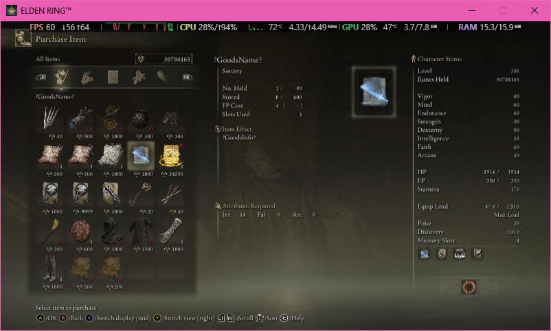
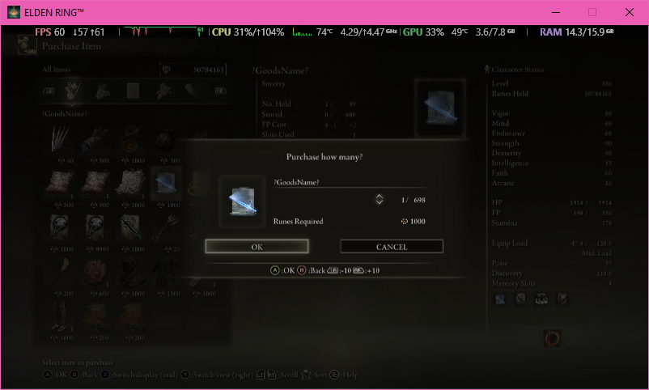
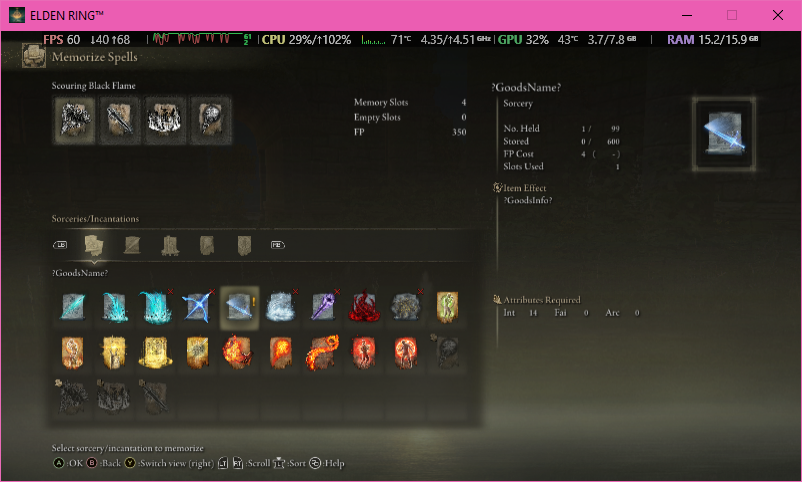
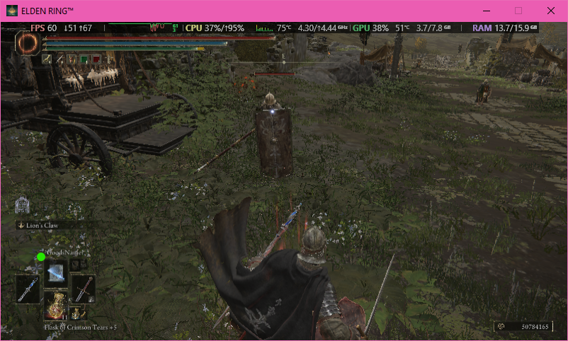
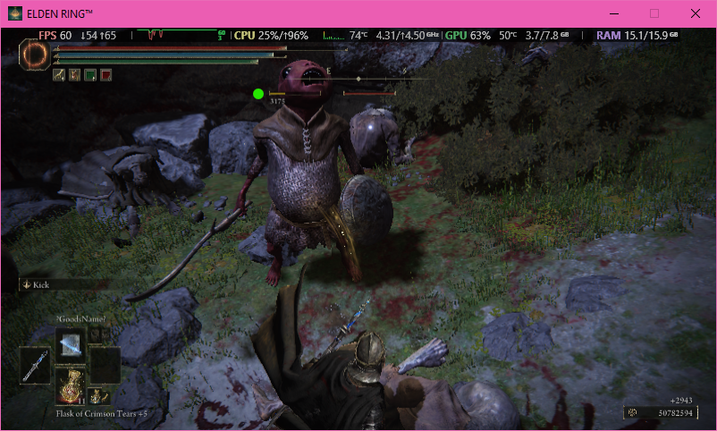

# การทดสอบ Extension Innovate-Items Spells (Phase 2)

## Group A. kind: attack and the attack rows of a projectile (Phase 2.4; passed in the game 2026-10-11)

_(Manual Test Reference: [manual-test-plan-1.7.0](../docs/manual-test-plan-1.7.0.md#a-kind-attack-and-the-attack-rows-of-a-projectile-phase-24-passed-in-the-game-2026-10-11))_

**Before start: completing rebuild .exe tools first**:

```commandLine
python .\code\tools\dev_pipeline.py
```

**Result:**

```commandLine
PS D:\StudioProjects\Elden-Disk> python .\code\tools\dev_pipeline.py
[E2E Pipeline] Step 1/2: Running the tests (pytest)...
======================================================== test session starts ========================================================
platform win32 -- Python 3.14.5, pytest-9.0.3, pluggy-1.6.0
rootdir: D:\StudioProjects\Elden-Disk\code
plugins: anyio-4.13.0, asyncio-1.4.0
asyncio: mode=Mode.STRICT, debug=False, asyncio_default_fixture_loop_scope=None, asyncio_default_test_loop_scope=function
collected 1225 items

tests\test_architecture.py ............................................................s...................................... [  8%]
...................................                                                                                            [ 10%]
tests\test_attach.py ..                                                                                                        [ 11%]
tests\test_cli_logging.py .........                                                                                            [ 11%]
tests\test_console.py ...                                                                                                      [ 12%]
tests\test_convert_state_ids.py ...                                                                                            [ 12%]
tests\test_dev_pipeline.py ....................                                                                                [ 13%]
tests\test_disk.py ..................................                                                                          [ 16%]
tests\test_export.py ........                                                                                                  [ 17%]
tests\test_ext_clone.py ....................................................sssssssssssss                                      [ 22%]
tests\test_ext_enchant.py .............................sssssssssssss                                                           [ 26%]
tests\test_ext_gate.py ....                                                                                                    [ 26%]
tests\test_ext_golden.py ssssssssssssssssssssssssssssssssssssssssssssssss                                                      [ 30%]
tests\test_ext_grow.py ............................                                                                            [ 32%]
tests\test_ext_primitives.py ..s.s............                                                                                 [ 34%]
tests\test_ext_projectile.py ..............................sssssssssss............sssss                                        [ 38%]
tests\test_ext_service.py ...................................                                                                  [ 41%]
tests\test_ext_spec.py .....................................................                                                   [ 45%]
tests\test_extension_command.py ...........................                                                                    [ 48%]
tests\test_gamefolder.py ....                                                                                                  [ 48%]
tests\test_host.py .........................................                                                                   [ 51%]
tests\test_launcher.py ..                                                                                                      [ 52%]
tests\test_ledger.py ...........                                                                                               [ 52%]
tests\test_logbook.py ............                                                                                             [ 53%]
tests\test_main.py ..............................................                                                              [ 57%]
tests\test_memory_writer.py .....................................                                                              [ 60%]
tests\test_param_check.py .....................s                                                                               [ 62%]
tests\test_param_tables.py ..........................s                                                                         [ 64%]
tests\test_param_write.py ...........................                                                                          [ 66%]
tests\test_params.py ........................................................................                                  [ 72%]
tests\test_probe.py ...........                                                                                                [ 73%]
tests\test_profile_policy.py .........                                                                                         [ 74%]
tests\test_read_command.py .............................................                                                       [ 78%]
tests\test_regulation.py ..............................                                                                        [ 80%]
tests\test_run_command.py ............                                                                                         [ 81%]
tests\test_save_vault.py .............................                                                                         [ 83%]
tests\test_soak_check.py ..                                                                                                    [ 84%]
tests\test_ui.py ...............................................                                                               [ 87%]
tests\test_values.py ..........................................................................                                [ 93%]
tests\test_vault_command.py ...................                                                                                [ 95%]
tests\test_vault_location.py .......                                                                                           [ 96%]
tests\test_write_command.py .................................................                                                  [100%]

================================================= 1130 passed, 95 skipped in 27.76s =================================================
[E2E Pipeline] SUCCESS: tests passed.
[E2E Pipeline] Step 2/2: Building standalone eldendisk.exe for version 1.7.0 (pyinstaller, onefile; this takes a while)...
[E2E Pipeline] cleaning previous build artifacts
50 DEPRECATION: Running PyInstaller as admin is not necessary nor sensible. Run PyInstaller from a non-administrator terminal. PyInstaller 7.0 will block this.
176 INFO: PyInstaller: 6.22.3, contrib hooks: 2026.8
176 INFO: Python: 3.14.5
210 INFO: Platform: Windows-10-10.0.19045-SP0
210 INFO: Python environment: C:\Users\loveg\AppData\Local\Python\pythoncore-3.14-64
211 INFO: wrote D:\StudioProjects\Elden-Disk\build\work\eldendisk.spec
215 INFO: Module search paths (PYTHONPATH):
['D:\\StudioProjects\\Elden-Disk',
 'C:\\Users\\loveg\\AppData\\Local\\Python\\pythoncore-3.14-64\\python314.zip',
 'C:\\Users\\loveg\\AppData\\Local\\Python\\pythoncore-3.14-64\\DLLs',
 'C:\\Users\\loveg\\AppData\\Local\\Python\\pythoncore-3.14-64\\Lib',
 'C:\\Users\\loveg\\AppData\\Local\\Python\\pythoncore-3.14-64',
 'C:\\Users\\loveg\\AppData\\Local\\Python\\pythoncore-3.14-64\\Lib\\site-packages',
 'D:\\StudioProjects\\Elden-Disk\\code']
650 INFO: Appending 'datas' from .spec
651 INFO: checking Analysis
651 INFO: Building Analysis because Analysis-00.toc is non existent
651 INFO: Looking for Python shared library...
651 INFO: Using Python shared library: C:\Users\loveg\AppData\Local\Python\pythoncore-3.14-64\python314.dll
651 INFO: Running Analysis Analysis-00.toc
651 INFO: Target bytecode optimization level: 0
651 INFO: Initializing module dependency graph...
652 INFO: Initializing module graph hook caches...
698 INFO: Analyzing modules for base_library.zip ...
1800 INFO: Processing standard module hook 'hook-math.py' from 'C:\\Users\\loveg\\AppData\\Local\\Python\\pythoncore-3.14-64\\Lib\\site-packages\\PyInstaller\\hooks'
1823 INFO: Processing standard module hook 'hook-heapq.py' from 'C:\\Users\\loveg\\AppData\\Local\\Python\\pythoncore-3.14-64\\Lib\\site-packages\\PyInstaller\\hooks'
2157 INFO: Processing standard module hook 'hook-encodings.py' from 'C:\\Users\\loveg\\AppData\\Local\\Python\\pythoncore-3.14-64\\Lib\\site-packages\\PyInstaller\\hooks'
3795 INFO: Processing standard module hook 'hook-difflib.py' from 'C:\\Users\\loveg\\AppData\\Local\\Python\\pythoncore-3.14-64\\Lib\\site-packages\\PyInstaller\\hooks'
3902 INFO: Processing standard module hook 'hook-pickle.py' from 'C:\\Users\\loveg\\AppData\\Local\\Python\\pythoncore-3.14-64\\Lib\\site-packages\\PyInstaller\\hooks'
5340 INFO: Caching module dependency graph...
5378 INFO: Analyzing D:\StudioProjects\Elden-Disk\code\eldendisk\__main__.py
5479 INFO: Processing standard module hook 'hook-sysconfig.py' from 'C:\\Users\\loveg\\AppData\\Local\\Python\\pythoncore-3.14-64\\Lib\\site-packages\\PyInstaller\\hooks'
5486 INFO: Processing standard module hook 'hook-_ctypes.py' from 'C:\\Users\\loveg\\AppData\\Local\\Python\\pythoncore-3.14-64\\Lib\\site-packages\\PyInstaller\\hooks'
6086 INFO: Processing module hooks (post-graph stage)...
6104 INFO: Performing binary vs. data reclassification (4 entries)
6108 INFO: Looking for ctypes DLLs
6129 INFO: Analyzing run-time hooks ...
6130 INFO: Including run-time hook 'pyi_rth_inspect.py' from 'C:\\Users\\loveg\\AppData\\Local\\Python\\pythoncore-3.14-64\\Lib\\site-packages\\PyInstaller\\hooks\\rthooks'
6138 INFO: Creating base_library.zip...
6163 INFO: Looking for dynamic libraries
6305 INFO: Extra DLL search directories (AddDllDirectory): []
6305 INFO: Extra DLL search directories (PATH): []
6600 INFO: Warnings written to D:\StudioProjects\Elden-Disk\build\work\eldendisk\warn-eldendisk.txt
6625 INFO: Graph cross-reference written to D:\StudioProjects\Elden-Disk\build\work\eldendisk\xref-eldendisk.html
6647 INFO: checking PYZ
6647 INFO: Building PYZ because PYZ-00.toc is non existent
6647 INFO: Building PYZ (ZlibArchive) D:\StudioProjects\Elden-Disk\build\work\eldendisk\PYZ-00.pyz
6765 INFO: Building PYZ (ZlibArchive) D:\StudioProjects\Elden-Disk\build\work\eldendisk\PYZ-00.pyz completed successfully.
6788 INFO: checking PKG
6788 INFO: Building PKG because PKG-00.toc is non existent
6788 INFO: Building PKG (CArchive) eldendisk.pkg
7488 INFO: Building PKG (CArchive) eldendisk.pkg completed successfully.
7490 INFO: Bootloader C:\Users\loveg\AppData\Local\Python\pythoncore-3.14-64\Lib\site-packages\PyInstaller\bootloader\Windows-64bit-intel\run.exe
7490 INFO: checking EXE
7490 INFO: Building EXE because EXE-00.toc is non existent
7491 INFO: Building EXE from EXE-00.toc
7496 INFO: Copying bootloader EXE to D:\StudioProjects\Elden-Disk\build\dist\eldendisk.exe
7511 INFO: Copying icon to EXE
7522 INFO: Copying 0 resources to EXE
7523 INFO: Embedding manifest in EXE
7531 INFO: Appending PKG archive to EXE
7630 INFO: Fixing EXE headers
7856 INFO: Building EXE from EXE-00.toc completed successfully.
7859 INFO: Build complete! The results are available in: D:\StudioProjects\Elden-Disk\build\dist
[E2E Pipeline] SUCCESS: Executable compiled successfully: ./build/dist/eldendisk.exe
[E2E Pipeline] Done:
  exe       D:\StudioProjects\Elden-Disk\build\dist\eldendisk.exe
  size      9.4 MB (9,873,529 bytes)
  sha256    dc574cd25503807f55c97a61de0c0e912d7e4a58447596a284acdbcf5a882a5b
  version   1.7.0 (pyinstaller, onefile)
  configs   offsets.json, chr_state_ids.json, extension.json embedded in the exe
  readme    D:\StudioProjects\Elden-Disk\build\dist\README.md
  tests     28.5 s
  build     8.1 s
  total     36.6 s
  data      %LOCALAPPDATA%\EldenDisk (the vault, the extensions' files and the exports; the exe can be copied anywhere)
  start it  .\build\dist\eldendisk.exe run -v
PS D:\StudioProjects\Elden-Disk>
```

**Remark:** block end of process 

```commandLine
[E2E Pipeline] Done:
  exe       D:\StudioProjects\Elden-Disk\build\dist\eldendisk.exe
  size      9.4 MB (9,873,529 bytes)
  sha256    dc574cd25503807f55c97a61de0c0e912d7e4a58447596a284acdbcf5a882a5b
  version   1.7.0 (pyinstaller, onefile)
  configs   offsets.json, chr_state_ids.json, extension.json embedded in the exe
  readme    D:\StudioProjects\Elden-Disk\build\dist\README.md
  tests     28.5 s
  build     8.1 s
  total     36.6 s
  data      %LOCALAPPDATA%\EldenDisk (the vault, the extensions' files and the exports; the exe can be copied anywhere)
  start it  .\build\dist\eldendisk.exe run -v
```

_ตัวลิ้งควรกดได้ และควรออกแบบสีสันให้จุดต่างๆ ด้วยนะ ตามที่ออกแบบไว้ใน Log แต่โดยรวมแล้วถือว่า **ผ่าน**_

### A0

**Do:** slot 4 เดิม รัน --add all --dry-run ต้องขึ้น gate passed (26 blocks re-encoded) แล้ว run ยิง Black Flame ที่ copy ต้องเหมือนเดิม

**Add all extension innovate spelss into process and build `regulation.bin` with `--dry-run`:**

```commandLine
PS D:\StudioProjects\Elden-Disk\build\dist> .\eldendisk.exe extension innovate-items spells --add all --dry-run
 ·  ext    innovate-items spells: building reverse_curse_technique, black_flame_copy, black_flame_blade_copy, black_flame_long_burn on D:\SteamLibrary\steamapps\common\ELDEN RING\Game\regulation.bin and checking (about 20 s)
 ✓  ext    innovate-items spells: reverse_curse_technique, black_flame_copy, black_flame_blade_copy, black_flame_long_burn built, gate passed (26 blocks re-encoded)
     sha256       74e5e546930067c4…
     content      34b71f9c511099a1…
     would write  C:\Users\loveg\AppData\Local\EldenDisk\vault\extension\innovate-items\spells\regulation.bin
     next         run again without --dry-run to write it
PS D:\StudioProjects\Elden-Disk\build\dist>
```

**After testing build `regulation.bin` passed, go to run the game:**

```commandLine
PS D:\StudioProjects\Elden-Disk\build\dist> .\eldendisk.exe run --vault-on -v
10-11 01:31:11.755 36696 D client: version 1.7.0
10-11 01:31:11.756 36696 D client: run: eldendisk.exe run --vault-on -v
10-11 01:31:11.756 36696 D client: clickable paths on: WT_SESSION is set
10-11 01:31:12.455 36696 D config: offsets: D:\tmp\_MEI000041a42\offsets.json (embedded)
10-11 01:31:12.457 36696 D config: design: D:\tmp\_MEI000041a42\extension.json (embedded)
10-11 01:31:12.463 36696 I ext   : innovate-items spells: building because no secured build yet (first run, or spells.commit.json was deleted)
10-11 01:31:12.464 36696 I ext   : innovate-items spells: building reverse_curse_technique, black_flame_copy, black_flame_blade_copy, black_flame_long_burn on D:\SteamLibrary\steamapps\common\ELDEN RING\Game\regulation.bin and checking (about 20 s)
10-11 01:31:30.138 36696 D ext   : gate: the second decoder (compression.zstd) agrees
10-11 01:31:30.139 36696 I ext   : innovate-items spells: reverse_curse_technique, black_flame_copy, black_flame_blade_copy, black_flame_long_burn built, gate passed (26 blocks re-encoded) -> C:\Users\loveg\AppData\Local\EldenDisk\vault\extension\innovate-items\spells\regulation.bin
10-11 01:31:30.139 36696 D config: vault: C:\Users\loveg\AppData\Local\EldenDisk\vault
10-11 01:31:30.143 36696 D config: save: C:\Users\loveg\AppData\Roaming\EldenRing\76561198296924569
10-11 01:31:30.144 36696 D config: game: D:\SteamLibrary\steamapps\common\ELDEN RING\Game
10-11 01:31:30.144 36696 D config: mode: vault ON (backup before, restore after)
10-11 01:31:30.145 36696 D config: regulation: C:\Users\loveg\AppData\Local\EldenDisk\vault\extension\innovate-items\spells\regulation.bin (new build, gate passed) replaces the game's regulation.bin for this session
10-11 01:31:30.157 36696 W steam : Steam is running: Steam Cloud may sync the save when the game exits (not verified). Use Steam offline mode, or turn Steam Cloud off for Elden Ring
10-11 01:31:30.159 36696 D host  : state PREFLIGHT
10-11 01:31:30.159 36696 D vault : status ON
10-11 01:31:30.181 36696 D host  : state SNAPSHOTTING
10-11 01:31:30.539 36696 D vault : save 76561198296924569 -> snapshot 20261011-013130
10-11 01:31:30.540 36696 I vault : snapshot 20261011-013130, 5 files verified
10-11 01:31:30.566 36696 I vault : game's regulation.bin backed up to 20261011-013130/bin (sha256 766521f9508d)
10-11 01:31:30.578 36696 D host  : state READY
10-11 01:31:30.607 36696 I vault : regulation.bin: your file replaces the game's for this session (sha256 74e5e5469300)
10-11 01:31:30.608 36696 I game  : launching eldenring.exe offline
10-11 01:31:30.648 36696 I game  : running, pid 48832; read allowed, write allowed
10-11 01:31:30.649 36696 D host  : state RUNNING
10-11 01:34:36.768 36696 I game  : exited
10-11 01:34:37.770 36696 D host  : state RESTORING
10-11 01:34:38.116 36696 I vault : modified ER0000.err, ER0000.err.bak, ER0000.sl2, ER0000.sl2.bak, steam_autocloud.vdf archived to C:\Users\loveg\AppData\Local\EldenDisk\vault\20261011-013130\contaminated
10-11 01:34:38.497 36696 D vault : restored C:\Users\loveg\AppData\Local\EldenDisk\vault\20261011-013130 -> C:\Users\loveg\AppData\Roaming\EldenRing\76561198296924569
10-11 01:34:38.612 36696 I vault : ER0000.err, ER0000.err.bak, ER0000.sl2, ER0000.sl2.bak, steam_autocloud.vdf restored, byte-identical to the snapshot
10-11 01:34:38.666 36696 I vault : regulation.bin restored, byte-identical to the game's own file
10-11 01:34:38.676 36696 D host  : state IDLE
10-11 01:34:38.694 36696 I vault : pruned 1 old snapshot(s), kept the newest 5
10-11 01:34:38.696 36696 D vault : pruned: 20261010-043452
10-11 01:34:38.697 36696 I ext   : this regulation.bin was built just now. If it worked in the game, keep it for next time: eldendisk extension innovate-items spells --secure   (game closed)
10-11 01:34:38.697 36696 D client: exit 0
PS D:\StudioProjects\Elden-Disk\build\dist>
```

**Remark:** เปิดเกมได้เข้าหน้า **Title** กด **Continue** -> **World Loaded** -> **Merchant Kalé** มีของใหม่ในร้านขาย 4 ชิ้น -> ชื้อ, ร่าย, เล่นได้ตามที่คาดไว้ -> **Return to Desktop** 

**Result:** **ผ่าน**

### A1

**Do:** ใส่ slot 5 ใน extension.json แทนบรรทัด `<id-5>: null` ด้วย `"strike_copy": {"kind":"attack","from":4440,"fp_cost":4,"shop":{"price":1000,"stock":-1}}` แล้ว `dry-run`, `run`, ซื้อ, จด, ร่าย

**Change Subject `extension.json` Slot 5:** 

```json
{
  "strike_copy": {
    "kind": "attack",
    "from": 4440,
    "fp_cost": 4,
    "shop": {
      "price": 1000,
      "stock": -1
    }
  }
}
```


**Test build `regulation.bin` with `--dry-run`**

```commandLine
PS D:\StudioProjects\Elden-Disk\build\dist> .\eldendisk.exe extension innovate-items spells --add all --dry-run
 ·  ext    innovate-items spells: building reverse_curse_technique, black_flame_copy, black_flame_blade_copy, black_flame_long_burn, strike_copy on D:\SteamLibrary\steamapps\common\ELDEN RING\Game\regulation.bin and checking (about 20 s)
 ✓  ext    innovate-items spells: reverse_curse_technique, black_flame_copy, black_flame_blade_copy, black_flame_long_burn, strike_copy built, gate passed (26 blocks re-encoded)
     sha256       12cc5e96e69f378d…
     content      3f48293f6d61241c…
     would write  C:\Users\loveg\AppData\Local\EldenDisk\vault\extension\innovate-items\spells\regulation.bin
     next         run again without --dry-run to write it
PS D:\StudioProjects\Elden-Disk\build\dist>
```

**Test running the game:**

```commandLine
PS D:\StudioProjects\Elden-Disk\build\dist> .\eldendisk.exe run --vault-on -v
10-11 01:44:26.158 24224 D client: version 1.7.0
10-11 01:44:26.159 24224 D client: run: eldendisk.exe run --vault-on -v
10-11 01:44:26.159 24224 D client: clickable paths on: WT_SESSION is set
10-11 01:44:28.039 24224 D config: offsets: D:\tmp\_MEI000087142\offsets.json (embedded)
10-11 01:44:28.040 24224 D config: design: D:\tmp\_MEI000087142\extension.json (embedded)
10-11 01:44:28.049 24224 I ext   : innovate-items spells: building because no secured build yet (first run, or spells.commit.json was deleted)
10-11 01:44:28.050 24224 I ext   : innovate-items spells: building reverse_curse_technique, black_flame_copy, black_flame_blade_copy, black_flame_long_burn, strike_copy on D:\SteamLibrary\steamapps\common\ELDEN RING\Game\regulation.bin and checking (about 20 s)
10-11 01:44:45.076 24224 D ext   : gate: the second decoder (compression.zstd) agrees
10-11 01:44:45.077 24224 I ext   : innovate-items spells: reverse_curse_technique, black_flame_copy, black_flame_blade_copy, black_flame_long_burn, strike_copy built, gate passed (26 blocks re-encoded) -> C:\Users\loveg\AppData\Local\EldenDisk\vault\extension\innovate-items\spells\regulation.bin
10-11 01:44:45.078 24224 D config: vault: C:\Users\loveg\AppData\Local\EldenDisk\vault
10-11 01:44:45.078 24224 D config: save: C:\Users\loveg\AppData\Roaming\EldenRing\76561198296924569
10-11 01:44:45.079 24224 D config: game: D:\SteamLibrary\steamapps\common\ELDEN RING\Game
10-11 01:44:45.087 24224 D config: mode: vault ON (backup before, restore after)
10-11 01:44:45.087 24224 D config: regulation: C:\Users\loveg\AppData\Local\EldenDisk\vault\extension\innovate-items\spells\regulation.bin (new build, gate passed) replaces the game's regulation.bin for this session
10-11 01:44:45.100 24224 W steam : Steam is running: Steam Cloud may sync the save when the game exits (not verified). Use Steam offline mode, or turn Steam Cloud off for Elden Ring
10-11 01:44:45.102 24224 D host  : state PREFLIGHT
10-11 01:44:45.103 24224 D vault : status ON
10-11 01:44:45.128 24224 D host  : state SNAPSHOTTING
10-11 01:44:45.482 24224 D vault : save 76561198296924569 -> snapshot 20261011-014445
10-11 01:44:45.483 24224 I vault : snapshot 20261011-014445, 5 files verified
10-11 01:44:45.504 24224 I vault : game's regulation.bin backed up to 20261011-014445/bin (sha256 766521f9508d)
10-11 01:44:45.523 24224 D host  : state READY
10-11 01:44:45.542 24224 I vault : regulation.bin: your file replaces the game's for this session (sha256 12cc5e96e69f)
10-11 01:44:45.543 24224 I game  : launching eldenring.exe offline
10-11 01:44:45.565 24224 I game  : running, pid 44900; read allowed, write allowed
10-11 01:44:45.566 24224 D host  : state RUNNING
10-11 01:57:17.905 42900 D client: version 1.7.0
10-11 01:57:17.906 42900 D client: run: eldendisk.exe read --query character.* --flat
10-11 01:57:19.058 42900 D config: offsets: D:\tmp\_MEI000078202\offsets.json (embedded)
10-11 01:57:19.059 42900 D config: state ids: D:\tmp\_MEI000078202\chr_state_ids.json (embedded)
10-11 01:57:19.071 42900 D read  : query character.*: 24 result(s)
10-11 01:57:19.080 42900 D client: exit 0
10-11 01:57:52.577 36632 D client: version 1.7.0
10-11 01:57:52.577 36632 D client: run: eldendisk.exe write --set character.attributes.intelligence=99
10-11 01:57:52.690 36632 D write : [write] intelligence: set to 99
10-11 01:57:52.691 36632 I write : intelligence = 99
10-11 01:57:52.691 36632 D client: exit 0
10-11 02:00:21.050 24224 I game  : exited
10-11 02:00:22.054 24224 D host  : state RESTORING
10-11 02:00:22.399 24224 I vault : modified ER0000.err, ER0000.err.bak, ER0000.sl2, ER0000.sl2.bak, steam_autocloud.vdf archived to C:\Users\loveg\AppData\Local\EldenDisk\vault\20261011-014445\contaminated
10-11 02:00:22.724 24224 D vault : restored C:\Users\loveg\AppData\Local\EldenDisk\vault\20261011-014445 -> C:\Users\loveg\AppData\Roaming\EldenRing\76561198296924569
10-11 02:00:22.831 24224 I vault : ER0000.err, ER0000.err.bak, ER0000.sl2, ER0000.sl2.bak, steam_autocloud.vdf restored, byte-identical to the snapshot
10-11 02:00:22.878 24224 I vault : regulation.bin restored, byte-identical to the game's own file
10-11 02:00:22.888 24224 D host  : state IDLE
10-11 02:00:22.915 24224 I vault : pruned 1 old snapshot(s), kept the newest 5
10-11 02:00:22.916 24224 D vault : pruned: 20261010-043735
10-11 02:00:22.916 24224 I ext   : this regulation.bin was built just now. If it worked in the game, keep it for next time: eldendisk extension innovate-items spells --secure   (game closed)
10-11 02:00:22.917 24224 D client: exit 0
PS D:\StudioProjects\Elden-Disk\build\dist>
```







**Remark:** เปิดเกมได้เข้าหน้า **Title** กด **Continue** -> **World Loaded** -> **Merchant Kalé** มีของใหม่ในร้านขาย 5 ชิ้น -> ชื้อ, ร่าย, เล่นได้ตามที่คาดไว้ -> **Return to Desktop**

**Result: ผ่าน**

### A2, A3

**DO:** `read --param-check` ต้องเท่ากันทุกแถว และ `read --param AtkParam_Pc.710000032.atkMag` ต้องได้ `180`


**Checking the innovated `regulation.bin` with the game memory:**

```commandLine
PS D:\StudioProjects\Elden-Disk> .\build\dist\eldendisk.exe read --param-check
 02:12:19  ·  read   opening the game folder's regulation.bin, D:\SteamLibrary\steamapps\common\ELDEN RING\Game\regulation.bin (a few seconds)
  Goods        2334 rows in the file, 2334 in the game: 2334 equal
  Magic        322 rows in the file, 322 in the game: 322 equal
  SpEffect     11360 rows in the file, 11360 in the game: 11360 equal
  Bullet       15479 rows in the file, 15479 in the game: 15479 equal
  AtkParam_Pc  11025 rows in the file, 11025 in the game: 11025 equal
  ShopLineup   1301 rows in the file, 1301 in the game: 1301 equal
 02:12:25  ✓  read   the file and the game agree on every row of the six tables
PS D:\StudioProjects\Elden-Disk>
```

**Reading the value of `AtkParam_Pc.710000032.atkMag`:**

```commandLine
PS D:\StudioProjects\Elden-Disk> .\build\dist\eldendisk.exe read --param AtkParam_Pc.710000032.atkMag --flat
 params.AtkParam_Pc.710000032.atkMag  180
```

**Result: ผ่าน**


### A4

**Do:** พิ่ม `set` ตั้ง `atkMag` 6 แถวเป็น `1800/1840` ตัว copy ต้องแรงขึ้นราว `10` เท่า ส่วน `4440` ตัวจริงต้องยัง `180`

**Change Subject `extension.json` Slot 5:** 

```json
{
  "strike_copy": {
    "kind": "attack",
    "from": 4440,
    "fp_cost": 4,
    "shop": {
      "price": 1000,
      "stock": -1
    },
    "set": {
      "AtkParam_Pc.44400.atkMag": 1800, 
      "AtkParam_Pc.44401.atkMag": 1800, 
      "AtkParam_Pc.44405.atkMag": 1800, 
      "AtkParam_Pc.44406.atkMag": 1800, 
      "AtkParam_Pc.44407.atkMag": 1840, 
      "AtkParam_Pc.44408.atkMag": 1840
    }
  }
}
```


**Running the game (whole log):**

```commandLine
PS D:\StudioProjects\Elden-Disk\build\dist> .\eldendisk.exe extension innovate-items spells --add all
 ·  ext    innovate-items spells: building reverse_curse_technique, black_flame_copy, black_flame_blade_copy, black_flame_long_burn, strike_copy on D:\SteamLibrary\steamapps\common\ELDEN RING\Game\regulation.bin and checking (about 20 s)
 !  client interrupted
PS D:\StudioProjects\Elden-Disk\build\dist> .\eldendisk.exe extension innovate-items spells --add all --dry-run
 ·  ext    innovate-items spells: building reverse_curse_technique, black_flame_copy, black_flame_blade_copy, black_flame_long_burn, strike_copy on D:\SteamLibrary\steamapps\common\ELDEN RING\Game\regulation.bin and checking (about 20 s)
 ✓  ext    innovate-items spells: reverse_curse_technique, black_flame_copy, black_flame_blade_copy, black_flame_long_burn, strike_copy built, gate passed (26 blocks re-encoded)
     sha256       6151ddec26e5e2d9…
     content      92b28879ef75385d…
     would write  C:\Users\loveg\AppData\Local\EldenDisk\vault\extension\innovate-items\spells\regulation.bin
     next         run again without --dry-run to write it
PS D:\StudioProjects\Elden-Disk\build\dist> .\eldendisk.exe run -v
10-11 02:26:18.090 31656 D client: version 1.7.0
10-11 02:26:18.090 31656 D client: run: eldendisk.exe run -v
10-11 02:26:18.091 31656 D client: clickable paths on: WT_SESSION is set
10-11 02:26:18.166 31656 D config: offsets: D:\tmp\_MEI000062082\offsets.json (embedded)
10-11 02:26:18.167 31656 D config: design: D:\tmp\_MEI000062082\extension.json (embedded)
10-11 02:26:18.174 31656 I ext   : innovate-items spells: building because no secured build yet (first run, or spells.commit.json was deleted)
10-11 02:26:18.178 31656 I ext   : innovate-items spells: building reverse_curse_technique, black_flame_copy, black_flame_blade_copy, black_flame_long_burn, strike_copy on D:\SteamLibrary\steamapps\common\ELDEN RING\Game\regulation.bin and checking (about 20 s)
10-11 02:26:34.974 31656 D ext   : gate: the second decoder (compression.zstd) agrees
10-11 02:26:34.975 31656 I ext   : innovate-items spells: reverse_curse_technique, black_flame_copy, black_flame_blade_copy, black_flame_long_burn, strike_copy built, gate passed (26 blocks re-encoded) -> C:\Users\loveg\AppData\Local\EldenDisk\vault\extension\innovate-items\spells\regulation.bin
10-11 02:26:34.976 31656 D config: vault: C:\Users\loveg\AppData\Local\EldenDisk\vault
10-11 02:26:34.976 31656 D config: save: C:\Users\loveg\AppData\Roaming\EldenRing\76561198296924569
10-11 02:26:34.976 31656 D config: game: D:\SteamLibrary\steamapps\common\ELDEN RING\Game
10-11 02:26:34.981 31656 D config: mode: vault ON (backup before, restore after)
10-11 02:26:34.981 31656 D config: regulation: C:\Users\loveg\AppData\Local\EldenDisk\vault\extension\innovate-items\spells\regulation.bin (new build, gate passed) replaces the game's regulation.bin for this session
10-11 02:26:34.991 31656 W steam : Steam is running: Steam Cloud may sync the save when the game exits (not verified). Use Steam offline mode, or turn Steam Cloud off for Elden Ring
10-11 02:26:34.993 31656 D host  : state PREFLIGHT
10-11 02:26:34.993 31656 D vault : status ON
10-11 02:26:35.011 31656 D host  : state SNAPSHOTTING
10-11 02:26:35.365 31656 D vault : save 76561198296924569 -> snapshot 20261011-022635
10-11 02:26:35.366 31656 I vault : snapshot 20261011-022635, 5 files verified
10-11 02:26:35.388 31656 I vault : game's regulation.bin backed up to 20261011-022635/bin (sha256 766521f9508d)
10-11 02:26:35.411 31656 D host  : state READY
10-11 02:26:35.427 31656 I vault : regulation.bin: your file replaces the game's for this session (sha256 6151ddec26e5)
10-11 02:26:35.428 31656 I game  : launching eldenring.exe offline
10-11 02:26:35.455 31656 I game  : running, pid 20976; read allowed, write allowed
10-11 02:26:35.456 31656 D host  : state RUNNING
10-11 02:30:42.974 47244 D client: version 1.7.0
10-11 02:30:42.974 47244 D client: run: eldendisk.exe read --query character.* --flat
10-11 02:30:44.188 47244 D config: offsets: D:\tmp\_MEI0000554c2\offsets.json (embedded)
10-11 02:30:44.188 47244 D config: state ids: D:\tmp\_MEI0000554c2\chr_state_ids.json (embedded)
10-11 02:30:44.192 47244 D read  : query character.*: 24 result(s)
10-11 02:30:44.196 47244 D client: exit 0
10-11 02:31:08.936  9688 D client: version 1.7.0
10-11 02:31:08.936  9688 D client: run: eldendisk.exe write --set character.attributes.intelligence=99
10-11 02:31:09.039  9688 D write : [write] intelligence: set to 99
10-11 02:31:09.039  9688 I write : intelligence = 99
10-11 02:31:09.040  9688 D client: exit 0
10-11 02:36:07.778 11728 D client: version 1.7.0
10-11 02:36:07.779 11728 D client: run: eldendisk.exe read --param-check
10-11 02:36:08.209 11728 I read  : opening the game folder's regulation.bin, D:\SteamLibrary\steamapps\common\ELDEN RING\Game\regulation.bin (a few seconds)
10-11 02:36:13.747 11728 D config: offsets: D:\tmp\_MEI000093a82\offsets.json (embedded)
10-11 02:36:13.748 11728 D config: state ids: D:\tmp\_MEI000093a82\chr_state_ids.json (embedded)
10-11 02:36:13.905 11728 I read  : the file and the game agree on every row of the six tables
10-11 02:36:13.911 11728 D client: exit 0
10-11 02:36:52.251 15160 D client: version 1.7.0
10-11 02:36:52.252 15160 D client: run: eldendisk.exe read --param AtkParam_Pc.710000032.atkMag --flat
10-11 02:36:52.336 15160 D config: offsets: D:\tmp\_MEI000085002\offsets.json (embedded)
10-11 02:36:52.336 15160 D config: state ids: D:\tmp\_MEI000085002\chr_state_ids.json (embedded)
10-11 02:36:52.339 15160 D client: exit 0
10-11 02:37:11.350 31656 I game  : exited
10-11 02:37:12.352 31656 D host  : state RESTORING
10-11 02:37:12.719 31656 I vault : modified ER0000.err, ER0000.err.bak, ER0000.sl2, ER0000.sl2.bak, steam_autocloud.vdf archived to C:\Users\loveg\AppData\Local\EldenDisk\vault\20261011-022635\contaminated
10-11 02:37:13.041 31656 D vault : restored C:\Users\loveg\AppData\Local\EldenDisk\vault\20261011-022635 -> C:\Users\loveg\AppData\Roaming\EldenRing\76561198296924569
10-11 02:37:13.154 31656 I vault : ER0000.err, ER0000.err.bak, ER0000.sl2, ER0000.sl2.bak, steam_autocloud.vdf restored, byte-identical to the snapshot
10-11 02:37:13.180 31656 I vault : regulation.bin restored, byte-identical to the game's own file
10-11 02:37:13.194 31656 D host  : state IDLE
10-11 02:37:13.253 31656 I vault : pruned 1 old snapshot(s), kept the newest 5
10-11 02:37:13.253 31656 D vault : pruned: 20261011-011317
10-11 02:37:13.253 31656 I ext   : this regulation.bin was built just now. If it worked in the game, keep it for next time: eldendisk extension innovate-items spells --secure   (game closed)
10-11 02:37:13.254 31656 D client: exit 0
PS D:\StudioProjects\Elden-Disk\build\dist>
```

**Checking the innovated `regulation.bin` with the game memory:**

```commandLine
PS D:\StudioProjects\Elden-Disk\build\dist> .\eldendisk read --param-check
 02:36:08  ·  read   opening the game folder's regulation.bin, D:\SteamLibrary\steamapps\common\ELDEN RING\Game\regulation.bin (a few seconds)
  Goods        2334 rows in the file, 2334 in the game: 2334 equal
  Magic        322 rows in the file, 322 in the game: 322 equal
  SpEffect     11360 rows in the file, 11360 in the game: 11360 equal
  Bullet       15479 rows in the file, 15479 in the game: 15479 equal
  AtkParam_Pc  11025 rows in the file, 11025 in the game: 11025 equal
  ShopLineup   1301 rows in the file, 1301 in the game: 1301 equal
 02:36:13  ✓  read   the file and the game agree on every row of the six tables
```

**Reading the value of `AtkParam_Pc.710000032.atkMag`:**

```commandLine
PS D:\StudioProjects\Elden-Disk\build\dist> .\eldendisk read --param AtkParam_Pc.710000032.atkMag --flat
 params.AtkParam_Pc.710000032.atkMag  1800
```



**Remark:** ดาเมจโคตรแรงเลยให้ตายเถอะ

**Result: ผ่าน**

### A5, A6

**Do:** เคส error สองอัน (attack จาก 6210 และ projectile จาก 4440) ต้องขึ้นข้อความ error และไม่ build อะไร

**1. Change Subject `extension.json` Slot 5: `--add all --dry-run`** 

```json
{
  "strike_copy": {
    "kind": "attack",
    "from": 6210,
    "fp_cost": 4,
    "shop": {
      "price": 1000,
      "stock": -1
    },
    "set": {
      "AtkParam_Pc.44400.atkMag": 1800, 
      "AtkParam_Pc.44401.atkMag": 1800, 
      "AtkParam_Pc.44405.atkMag": 1800, 
      "AtkParam_Pc.44406.atkMag": 1800, 
      "AtkParam_Pc.44407.atkMag": 1840, 
      "AtkParam_Pc.44408.atkMag": 1840
    }
  }
}
```

```commandLine
PS D:\StudioProjects\Elden-Disk\build\dist> .\eldendisk.exe extension innovate-items spells --add all --dry-run
 ·  ext    innovate-items spells: building reverse_curse_technique, black_flame_copy, black_flame_blade_copy, black_flame_long_burn, strike_copy on D:\SteamLibrary\steamapps\common\ELDEN RING\Game\regulation.bin and checking (about 20 s)
 ✖  ext    build failed: strike_copy (slot 5): `from` 6210 calls Bullet: kind attack needs a spell that makes a direct attack (an AtkParam_Pc row) and throws nothing (a spell that throws or creates a Bullet is kind projectile, one that only applies an effect is kind buff or enchant)
PS D:\StudioProjects\Elden-Disk\build\dist>
```

**2. Change Subject `extension.json` Slot 5: `--add all --dry-run`** 

```json
{
  "strike_copy": {
    "kind": "projectile",
    "from": 4440,
    "fp_cost": 4,
    "shop": {
      "price": 1000,
      "stock": -1
    },
    "set": {
      "AtkParam_Pc.44400.atkMag": 1800, 
      "AtkParam_Pc.44401.atkMag": 1800, 
      "AtkParam_Pc.44405.atkMag": 1800, 
      "AtkParam_Pc.44406.atkMag": 1800, 
      "AtkParam_Pc.44407.atkMag": 1840, 
      "AtkParam_Pc.44408.atkMag": 1840
    }
  }
}
```


```commandLine
PS D:\StudioProjects\Elden-Disk\build\dist> .\eldendisk.exe extension innovate-items spells --add all --dry-run
 ·  ext    innovate-items spells: building reverse_curse_technique, black_flame_copy, black_flame_blade_copy, black_flame_long_burn, strike_copy on D:\SteamLibrary\steamapps\common\ELDEN RING\Game\regulation.bin and checking (about 20 s)
 ✖  ext    build failed: strike_copy (slot 5): `from` 4440 calls AtkParam_Pc and no Bullet row: kind projectile needs a spell that throws or creates a Bullet (a spell that only applies an effect is kind buff or enchant, a direct attack is kind attack)
PS D:\StudioProjects\Elden-Disk\build\dist>
```

**Remark: build `regulation.bin` แตกทั้งคู้ (ถือว่าถูกต้อง)**

**Result: ผ่าน**

---

## Conclusion

จากการทดสอบ **Group**: **A0**, **A1**, **A2**, **A3**, **A4**, **A5**, และ **A6** ผ่านหมดจด!

จาก **Remark before start** ว่าด้วย End of build process, better console cli-ux

```commandLine
[E2E Pipeline] Done:
  exe       D:\StudioProjects\Elden-Disk\build\dist\eldendisk.exe
  size      9.4 MB (9,873,529 bytes)
  sha256    dc574cd25503807f55c97a61de0c0e912d7e4a58447596a284acdbcf5a882a5b
  version   1.7.0 (pyinstaller, onefile)
  configs   offsets.json, chr_state_ids.json, extension.json embedded in the exe
  readme    D:\StudioProjects\Elden-Disk\build\dist\README.md
  tests     28.5 s
  build     8.1 s
  total     36.6 s
  data      %LOCALAPPDATA%\EldenDisk (the vault, the extensions' files and the exports; the exe can be copied anywhere)
  start it  .\build\dist\eldendisk.exe run -v
```

_ตัวลิ้งควรกดได้ และควรออกแบบสีสันให้จุดต่างๆ ด้วยนะ ตามที่ออกแบบไว้ใน Log แต่โดยรวมแล้วถือว่า_