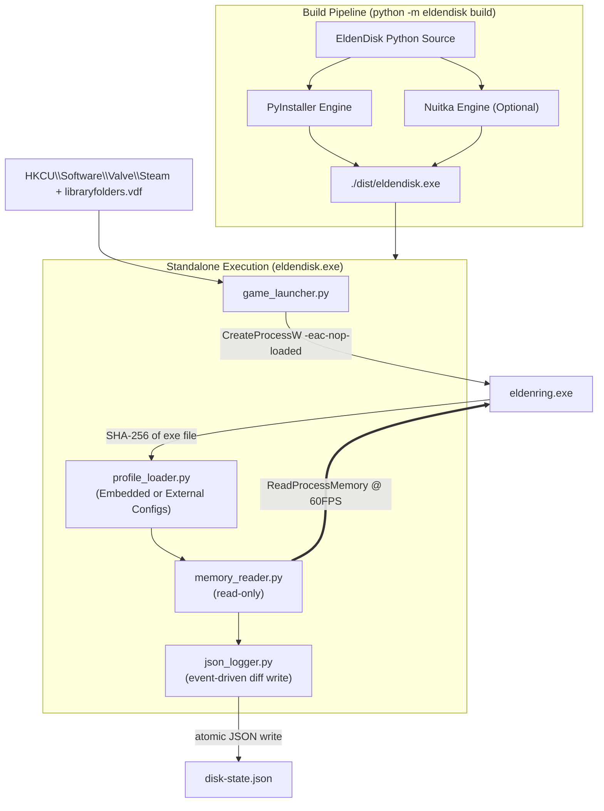
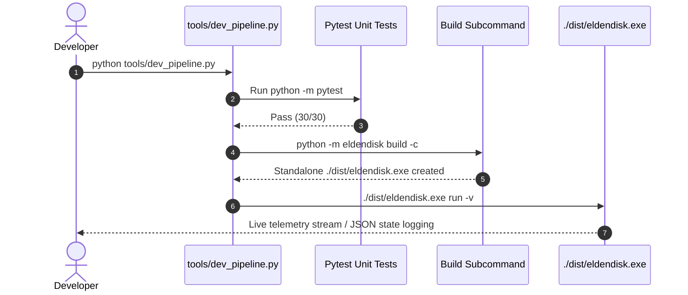

# EldenDisk Telemetry Tool
> **Proof of Concept (PoC) Specification**
> **Document Version:** 1.5.1 (revised from 1.5.0)
> **Date of Issue:** 2026-10-04
> **Target Platform:** Windows 10 / 11 (x64), Python 3.11+ (64-bit)
> **Game:** Elden Ring (Steam). Supported exe versions are listed in `offsets.json`

---

## 0. Changelog

### 1.5.0 → 1.5.1

| **#** | **Change** | **Reason** |
|:-----:|:-----------|:-----------|
|   1   | Introduce `build` CLI Command | Add `python -m eldendisk build` subcommand to compile the EldenDisk project into a single standalone executable (`eldendisk.exe`) located in `./dist`. |
|   2   | Dynamic Asset Resolution (`_MEIPASS` / Frozen Mode) | Update resource loading in frozen mode (`eldendisk.exe`) to resolve embedded configurations (`sys._MEIPASS`) or fall back to external files in the executable's directory. |
|   3   | Executable CLI Documentation (`cli-commands-exe.md`) | Create dedicated CLI reference documentation (`docs/cli-commands-exe.md`) reflecting executable command syntax (`eldendisk.exe <command>`). |
|   4   | End-to-End Development Pipeline (`tools/dev_pipeline.py`) | Establish a unified E2E script that automates pre-check unit testing, executable compilation, and telemetry verification. |

---

## 1. Executive Summary

A lightweight, **read-only** memory read tool featuring an **Event-Driven Persistence Architecture** for **offline** Elden Ring sessions. Version 1.5.1 expands distribution capabilities by compiling the application into a zero-dependency standalone executable (`eldendisk.exe`).

### Guarantees
1. **Single Executable Distribution.** The entire application and dependencies are packaged into `./dist/eldendisk.exe`.
2. **Offline only.** The game is started by running `eldenring.exe -eac-nop-loaded` directly. EAC is not loaded and online play is unavailable. The tool refuses to attach to any process showing EAC modules loaded.
3. **Read-only.** Only `PROCESS_VM_READ | PROCESS_QUERY_LIMITED_INFORMATION` is requested. No memory writes or injections.
4. **Zero disk changes in the game folder.** No file is created, modified, or deleted in the game folder.
5. **Flexible Asset Management.** Supports both embedded configurations (`--embed-configs`) and external live-swappable JSON configs (`offsets.json`, `chr_state_ids.json`).

---

## 2. Architecture



---

## 3. Build CLI Command (`build`)

### 3.1 Command Syntax
```commandline
python -m eldendisk build [OPTIONS]
```

### 3.2 Command Options

| Option | Alias | Type | Default | Description |
|:---|:---:|:---:|:---|:---|
| `--engine` | `-e` | `enum` | `pyinstaller` | Select build engine: `pyinstaller` (fast, standard) or `nuitka` (compiles to C/C++). |
| `--clean` | `-c` | `flag` | `False` | Clean `./build` and `./dist` cache directories prior to compilation. |
| `--embed-configs` | `-em` | `flag` | `False` | Embed `offsets.json` and `chr_state_ids.json` directly into the `.exe`. If omitted, the executable expects external JSON files in its directory. |
| `--icon` | `-i` | `string` | `None` | Path to `.ico` icon file (e.g., `--icon assets/icon.ico`). |

### 3.3 Output and Console Logging
Standard output during build execution:
```text
[INFO] Cleaning previous build artifacts...
[INFO] Initializing PyInstaller engine...
[INFO] Building eldendisk.exe (Onefile mode)...
[SUCCESS] Build complete! Standalone executable located at: ./dist/eldendisk.exe
```

### 3.4 Dynamic Asset Handling in Frozen Mode (`sys._MEIPASS`)
When running as a frozen binary (`getattr(sys, 'frozen', False)`):
1. **Embedded Assets:** If bundled via `--embed-configs`, resources are unpacked to `sys._MEIPASS`. Path resolution checks `Path(sys._MEIPASS) / filename` first.
2. **External Fallback:** If not embedded, path resolution falls back to `Path(sys.executable).parent / filename`.
3. **Schema File:** `disk.schema.json` is always accessible in frozen mode (bundled or resolved relative to module/executable).

---

## 4. End-to-End (E2E) Development Pipeline (`tools/dev_pipeline.py`)

To ensure parity between Python source execution and compiled executable runtime, the pipeline executes the following sequence:



---

## 5. Offline Launcher & Safety Logic

1. **Direct Launch:** Executes `<GameDir>\eldenring.exe -eac-nop-loaded`.
2. **Auto-Discovery:** Reads Steam registry and `libraryfolders.vdf`.
3. **EAC Guard:** Scans process modules; aborts immediately if `EasyAntiCheat` modules are detected.
4. **Read-Only Memory Access:** Requests `PROCESS_VM_READ | PROCESS_QUERY_LIMITED_INFORMATION` only.

---

## 6. Connection State Machine & Exit Codes

### 6.1 State Machine
- `WAITING_FOR_PROCESS`: Game process not running.
- `EAC_ACTIVE` / `EAC_DETECTED`: EasyAntiCheat present; attachment refused.
- `UNSUPPORTED_VERSION`: Game exe SHA-256 not matched in `offsets.json`.
- `WAITING_FOR_WORLD`: Process attached, but game pointers not initialized.
- `CONNECTED`: Memory polling active; `character` payload live.
- `DISCONNECTED`: Game process closed.
- `IDLE`: Game window unfocused; memory/disk polling paused.

### 6.2 Exit Codes
- `0`: Normal exit / success.
- `1`: Unrecoverable error / exception.
- `2`: Unsupported version / invalid argument error.
- `3`: EAC detected.
- `130`: User interrupt (Ctrl+C).

---

## 7. JSON Output Schema (v1.5.1)

Maintains full backward compatibility with schema v1.5.0 (`system_status` and `character` with `level`, `vitals`, `runes`, `attributes`, `effects`, `animations`).
